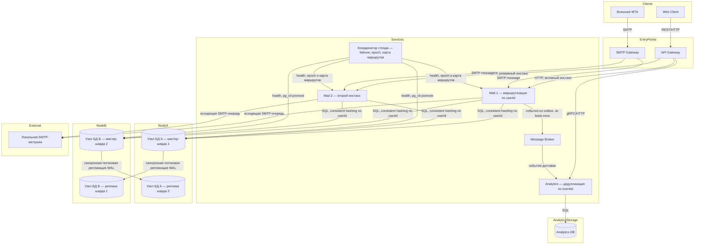
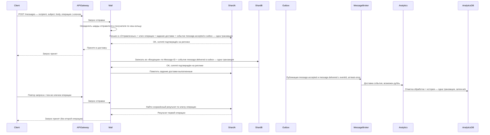
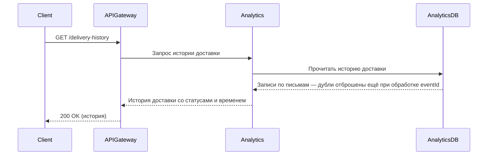
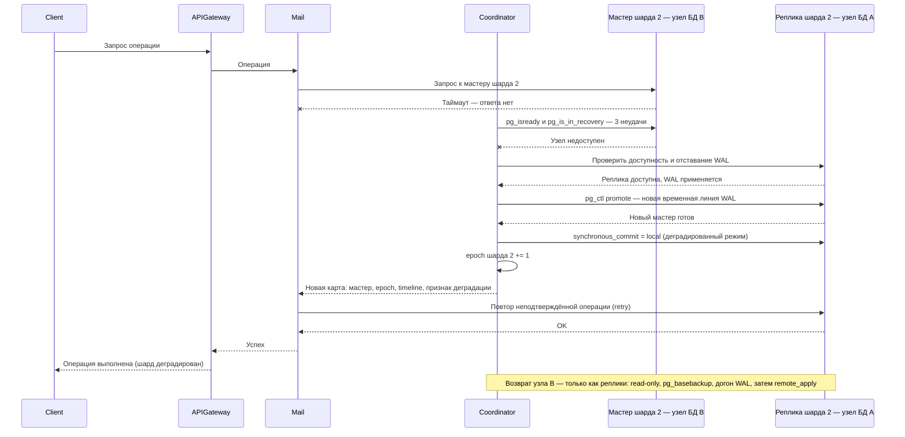
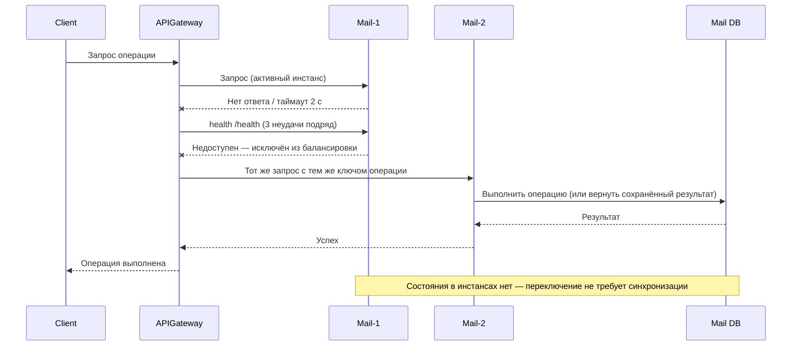
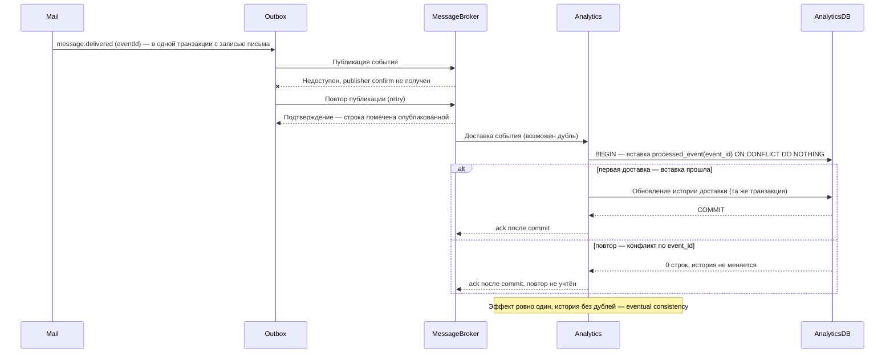

# Техническое решение проекта «Почтовый сервер»

## Введение

- **Краткое описание:**  
  «Почтовый сервер» — учебный проект, реализующий прототип распределённой почтовой системы. Система позволяет отправлять и получать письма по протоколу SMTP, читать почту и управлять письмами через веб-интерфейс. Проект демонстрирует ключевые принципы построения отказоустойчивых и масштабируемых распределённых приложений.

- **Цель проекта:**  
  реализовать прототип распределённой почтовой системы, которая доставляет письма пользователям и сохраняет их в соответствующих папках.

- **Задачи:**  
  закрепить теоретические основы распределённых систем (масштабируемость, отказоустойчивость, консистентность) через практическую реализацию; продемонстрировать применение концепций курса: ненадёжная доставка сообщений, частичные отказы, распределение данных и нагрузки, модели согласованности и интеграцию сервисов в распределённый конвейер обработки данных.

- **Состав команды:**  
  Иванов Кирилл (Тимлид), Шестаков Алексей (Разработчик, тестировщик), Дозмолин Никита (Разработчик), Дегтярев Евгений (Тестировщик)

---

## Глоссарий
| Термин        | Определение |
|---------------|-------------|
| Почтовый ящик | Учётная запись пользователя, хранящая входящие и исходящие письма. |
| Письмо        | Сообщение с заголовками (From, To, Subject, Message-ID) и телом; единица хранения и доставки. |
| Message-ID    | Уникальный идентификатор письма, назначаемый при отправке; используется для дедупликации доставки одного письма, но не определяет, являются ли два запроса одной операцией отправки. Для входящего SMTP повтор без Message-ID определяется по ограниченному составному отпечатку сообщения и получателя. |
| SMTP          | Протокол передачи почты между серверами (RFC 5321) и от клиента к серверу. |
| MX-запись     | DNS-запись, указывающая, какой сервер принимает почту для домена. |
| Папка         | Системное хранилище писем в ящике: «Входящие» (письма, адресованные пользователю) и «Отправленные» (копии отправленных им писем). Письмо попадает в папку по смыслу операции — при приёме или при отправке; пользовательских папок, ручного перемещения писем между папками и «Корзины» в объёме проекта нет. |
| API Gateway   | Точка входа для всех клиентских запросов веб-интерфейса. |
| Шард          | Независимый сегмент данных, размещённый на отдельном узле или группе узлов; в учебном стенде шардирование выполняется по `userId`. |
| Хеш-кольцо    | Способ распределения ключей по узлам (consistent hashing): узлы и ключи отображаются хеш-функцией на кольцо, ключ принадлежит ближайшему узлу по часовой стрелке. |
| Виртуальный узел | Дополнительная точка хеш-кольца, принадлежащая физическому узлу; повышает равномерность распределения ключей. |
| Мастер        | Узел PostgreSQL, принимающий записи в пределах своего шарда; остальные узлы шарда — реплики, доступные только для чтения. |
| Реплика       | Узел PostgreSQL в режиме восстановления (`pg_is_in_recovery() = true`), непрерывно применяющий WAL мастера своего шарда и готовый быть повышенным до мастера. |
| Потоковая репликация | Штатный механизм PostgreSQL: резервный узел получает базовую копию (`pg_basebackup`) и непрерывно применяет поток WAL мастера (`primary_conninfo`, `restore_command`). |
| Синхронная репликация | Режим записи, при котором COMMIT на мастере подтверждается только после применения записи на резервном узле того же шарда (`synchronous_standby_names`, `synchronous_commit = remote_apply`). Подтверждённая запись существует минимум на двух узлах. |
| Failover      | Автоматическое переключение на резервный узел при отказе основного: координатор стенда повышает реплику до мастера (`pg_ctl promote`) и публикует новую карту маршрутизации с новым `epoch`. |
| Временная линия WAL (timeline) | Номер ветви журнала WAL, который создаётся при промоушене реплики. Ветвь старого мастера после промоушена считается устаревшей, поэтому его разошедшиеся записи не могут стать частью системы. |
| Fencing       | Изоляция отказавшего мастера, исключающая его дальнейшие записи (защита от split-brain). Не опирается на осведомлённость старого мастера о новом состоянии; обеспечивается двумя внешними барьерами: (1) отзыв маршрута у координатора — новые записи на старый узел не направляются и не подтверждаются клиенту; (2) новая временная линия WAL у промоутированной реплики — при возврате старый мастер принимается только как реплика и пересоздаётся из копии нового мастера, а сделанные им в изоляции записи отбрасываются. |
| Деградированный режим шарда | Состояние шарда после failover, пока у него остался единственный живой узел: записи продолжают приниматься, но без синхронной репликации (`synchronous_commit = local`) до возврата второго узла шарда. |
| Инстанс Mail  | Отдельный экземпляр сервиса Mail, не хранящий состояния: два инстанса за API Gateway обслуживают клиентские запросы, при отказе одного запросы переносятся на другой. |
| Журнал обработанных событий (inbox) | Таблица в Analytics DB с уникальным `eventId`, фиксирующая факт обработки события; вставка отметки и запись результата выполняются одной транзакцией, поэтому повторная доставка не меняет результат. |
| Идемпотентность | Свойство операции: повтор того же запроса с тем же ключом операции (например, после потери ответа) не создаёт новый эффект. Одинаковые получатель, тема и текст сами по себе не означают одну операцию: две намеренные отправки остаются двумя письмами. |
| Ключ операции | Идентификатор конкретного запроса пользователя, позволяющий распознать его повтор после потери ответа; для новой намеренной отправки создаётся новый ключ. |
| Задание доставки | Надёжно сохранённая запись о необходимости передать письмо на шард получателя; обрабатывается с повторами и помечается выполненной только после успешной записи. |
| At-least-once | Семантика доставки сообщений: сообщение доставляется как минимум один раз, возможны дубли. |
| Transactional outbox | Паттерн: событие записывается в outbox-таблицу в той же транзакции, что и изменение данных, затем пересылается в брокер с повторами. |
| Message Broker | Посредник для асинхронной передачи событий между сервисами; может доставить одно событие более одного раза. |
| Analytics   | Сервис учёта событий доставки: принимает события `message.accepted` и `message.delivered` из брокера, дедуплицирует их по `eventId` и ведёт историю доставки (какое письмо, когда и на каком этапе доставлено). Содержимое писем не анализируется, ML-классификации в системе нет. |
| Event-ID    | Уникальный идентификатор факта изменения или действия; отличается от идентификатора письма и ключа операции. |
| Дедупликация  | Отбрасывание повторно доставленных копий одного события по идентификатору события; разные события для одного письма не отбрасываются. |
| Координатор стенда | Компонент учебного стенда, который выполняет health-проверки узлов, при отказе мастера повышает реплику (`pg_ctl promote`), увеличивает поколение шарда (`epoch`) и распространяет актуальную карту маршрутизации с номером временной линии WAL. Отказ самого координатора вне объёма проекта. |
| Health-проверка | Периодический или выполняемый после таймаута запрос, проверяющий доступность и готовность узла принимать операции. |
| Поколение шарда (`epoch`) | Монотонно увеличиваемый номер текущего владельца шарда, который хранит координатор и публикует вместе с адресом мастера и номером временной линии WAL. Mail отправляет записи только тому узлу, чей `epoch` совпадает с текущим в карте координатора; при несовпадении операция отклоняется с требованием обновить маршрут. Само число не является механизмом изоляции: изолированный узел о новом `epoch` не узнаёт и продолжает считать себя мастером, поэтому изоляцию обеспечивают отзыв маршрута и отбрасывание разошедшегося WAL (см. Fencing). |
| Eventual consistency | Модель согласованности: при отсутствии новых обновлений все копии данных со временем сходятся к одному состоянию. |

---

## Функциональные требования
Система должна предоставлять следующие функции:
1. Отправка писем пользователям внутри системы и на внешние почтовые домены по SMTP.  
2. Приём входящих писем по SMTP от внешних серверов и от внутренних пользователей.  
3. Просмотр почты через веб-интерфейс: список папок «Входящие» и «Отправленные» с количеством писем, открытие письма с отображением заголовков и тела; открытие письма помечает его прочитанным.
4. Удаление письма: выбранное правило — безвозвратное удаление. Команда удаления убирает письмо из папки, после чего письмо недоступно пользователю; «Корзина» и восстановление удалённых писем в объём проекта не входят. Повторное удаление уже удалённого письма не является ошибкой и возвращает прежний результат операции.
5. Просмотр истории доставки: пользователь видит по каждому отправленному письму два статуса конвейера — «принято в доставку» (исходная копия и задание доставки сохранены Mail DB) и «доставлено получателю» (письмо записано на шард получателя) — с временем каждого события. Отдельный признак «событие зафиксировано в истории доставки» показывает, что запись о доставке учтена сервисом Analytics; он относится только к учёту события в журнале и не означает никакой обработки содержимого письма. Классификация, категоризация и другие ML-функции в системе отсутствуют.

### Ограничения на предметную область

1. Почта работает только в пределах одного домена (например, `mail.example`); внешняя доставка демонстрируется через локальную SMTP-заглушку, а настоящие внешние домены и аутентификация SPF/DKIM/DMARC находятся вне объёма проекта.
2. Поддерживаются только текстовые письма.
3. Пользовательские ящики создаются администратором, самообслуживающая регистрация вне объёма проекта.

---

## Нефункциональные требования

1. **Сохранность результата отправки:** повтор того же запроса отправки с тем же ключом операции (например, после потери ответа) не создаёт вторую копию в папках пользователя. Намеренная новая отправка с теми же получателем, темой и текстом создаёт отдельное письмо с новым `Message-ID`. Уже подтверждённое системой письмо и его метаданные не теряются при отказе узла хранения; после восстановления пользователь видит тот же результат отправки и может повторить запрос без создания дубликата.
2. **Отказоустойчивость:** система должна продолжать работать при сбое одного из узлов: недоступность обнаруживается по таймаутам и health-проверкам; при отказе мастера шарда координатор автоматически повышает доступную реплику (failover) и публикует новую карту маршрутизации; при отказе инстанса Mail клиентские запросы продолжает обслуживать второй инстанс за API Gateway.
3. **Доставка событий:** семантика at-least-once; повторная доставка того же события не приводит к его повторной обработке (идемпотентность потребителя), но разные события для одного письма обрабатываются независимо. Отметка об обработке события и результат обработки фиксируются одной транзакцией, а подтверждение брокеру отправляется только после успешного commit. Поэтому повторная доставка не может ни потерять событие (ack до commit), ни применить его дважды (сначала история, потом отметка).
4. **Понятность интерфейса:** результат каждой операции пользователя однозначно отображается в веб-интерфейсе: письмо отправлено, получено, прочитано, удалено или операция отклонена с объяснением причины.
5. **Работа при отказе узла хранения:** при отказе узла хранения пользователь не может выполнять операции, требующие недоступных данных, и получает понятное сообщение о временной недоступности. После восстановления доступа уже подтверждённые письма и папки доступны в прежнем состоянии; подтверждённые письма не удаляются и не создаются повторно.
6. **Консистентность:** одно письмо не доставляется дважды при повторных SMTP-сессиях и повторной доставке одного события (дедупликация по `Message-ID` письма и идентификатору события соответственно); при отсутствии новых операций состояние папок и история доставки сходятся к полному состоянию (eventual consistency).  
7. **Восстановление данных после сбоев доставки событий:** после прекращения новых операций и восстановления доставки событий Analytics учитывает все сохранённые события, включая накопившиеся во время сбоя, ровно один раз по каждому идентификатору события.
8. **Сохранность записи при failover:** подтверждённая клиенту запись существует минимум на двух узлах, поэтому отказ одного узла хранения не приводит к её потере. В деградированном режиме шарда (после failover, пока второй узел не вернулся) запись подтверждается по одному узлу: это явное ограничение, о котором система сообщает в интерфейсе и логах, а синхронная репликация возвращается после восстановления второго узла шарда.

---

## Пользовательские сценарии

### Сценарий: отправка письма

**Участник:** авторизованный пользователь.

1. Пользователь открывает форму создания письма.
2. Пользователь указывает получателя, тему и текст письма и нажимает «Отправить».
3. Система сообщает об успешной отправке и показывает письмо в папке «Отправленные».
4. Получатель видит письмо в папке «Входящие».
5. Если ответ на отправку потерян, пользователь повторяет тот же запрос с тем же ключом операции: система не создаёт дубликат и показывает ранее полученный результат. Две намеренные отправки с одинаковыми получателем, темой и текстом являются отдельными письмами.

### Сценарий: получение письма

**Участник:** локальная SMTP-заглушка, имитирующая внешний отправитель, и получатель почты.

1. Локальная SMTP-заглушка открывает SMTP-сессию и имитирует внешний отправитель, отправляя письмо на адрес пользователя.
2. SMTP Gateway принимает письмо от заглушки и передаёт его в Mail.
3. Mail проверяет `Message-ID` в области конкретного ящика и помещает письмо во «Входящие». Если `Message-ID` отсутствует, Mail использует составной отпечаток заголовков и тела вместе с адресом получателя только для защиты от повтора этому получателю; такое письмо не считается глобально дедуплицированным для других получателей.
4. После успешного сохранения письма SMTP Gateway отвечает заглушке `250 OK`. Этот ответ означает, что письмо принято системой, но не является доказательством настоящей доставки во внешний домен.
5. Получатель открывает интерфейс и читает содержимое письма.

### Сценарий: чтение письма

**Участник:** получатель почты.

1. Пользователь открывает папку «Входящие» и видит список писем с отправителем, темой, датой и признаком прочтения.
2. Пользователь открывает письмо.
3. Система показывает заголовки (From, To, Subject, Message-ID) и тело письма и отмечает письмо прочитанным.
4. После возврата в список письмо отображается как прочитанное.

### Сценарий: удаление письма

**Участник:** получатель почты.

1. Пользователь удаляет письмо из папки; интерфейс предупреждает, что удаление безвозвратное.
2. Система удаляет письмо и сообщает результат операции.
3. Письмо исчезает из папки и больше не отображается в интерфейсе, при открытии по прямой ссылке возвращается «письмо не найдено».
4. Повторная команда удаления того же письма не является ошибкой: система возвращает прежний результат операции и не создаёт новую запись.

### Сценарий: просмотр истории доставки

**Участник:** отправитель письма.

1. Пользователь открывает страницу истории доставки.
2. Система показывает список отправленных писем со статусами «принято в доставку» и «доставлено получателю», временем каждого события и дополнительным признаком «зафиксировано в истории доставки» — отметкой о том, что событие учтено сервисом Analytics. Содержимое писем нигде не анализируется и не классифицируется.
3. Если брокер недоступен, история по последним письмам временно неполна, и интерфейс сообщает, что данные обновляются; после восстановления доставки событий статусы дополняются без дублей.

---

## Архитектура системы

Система построена как набор сервисов, взаимодействующих синхронно через API Gateway и асинхронно через Message Broker. Синхронный контур отвечает за приём пользовательских запросов и SMTP-сообщений, а асинхронный контур — за учёт событий доставки и ведение истории доставки. Содержимое писем нигде не анализируется и не классифицируется.

Основные компоненты:

1. **Web Client** — веб-интерфейс пользователя для работы с папками и письмами.
2. **SMTP Gateway** — принимает входящие SMTP-сессии от внешних серверов и внутренних клиентов, выполняет базовый разбор письма и передаёт его в Mail.
3. **API Gateway** — единая точка входа для запросов веб-клиента; выполняет маршрутизацию в Mail и Analytics, а также возвращает клиенту однозначный результат операции.
4. **Mail** — основной сервис почтовой системы. Он обрабатывает отправку и приём писем, проверяет ключ операции и `Message-ID`, выбирает шард по `userId`, управляет папками и записывает задания доставки и события в transactional outbox. Сервис не хранит состояния и запускается в двух взаимозаменяемых инстансах (`Mail-1`, `Mail-2`) за API Gateway.
5. **Message Broker** — передаёт события из transactional outbox в Analytics с семантикой at-least-once.
6. **Analytics** — потребляет события `message.accepted` и `message.delivered`, дедуплицирует их по `eventId` и ведёт историю доставки. Отметка об обработке и результат фиксируются одной транзакцией, подтверждение брокеру отправляется после commit.
7. **Analytics DB** — хранит историю обработанных событий и агрегированные сведения о доставке.
8. **Mail DB** — транзакционное шардированное хранилище писем, папок, ключей операций, заданий межшардовой доставки и outbox-событий на PostgreSQL 16. Шард — отдельный кластер со своим мастером и одной синхронной репликой; репликация потоковая, штатными средствами PostgreSQL. Мастер и реплика одного шарда всегда находятся на разных физических узлах хранения.
9. **Координатор стенда** — единственный владелец решения о смене владельца шарда: выполняет health-проверки узлов (`pg_isready`, `pg_is_in_recovery`, отставание реплики), при отказе мастера повышает реплику (`pg_ctl promote`), увеличивает поколение шарда (`epoch`) и публикует карту маршрутизации: логический шард → адрес мастера и реплики, `epoch`, номер временной линии WAL, признак деградированного режима. Координатор не пытается «заблокировать» недоступный узел: изоляция достигается отзывом маршрута и новой временной линией WAL.
10. **Локальная SMTP-заглушка внешней доставки** — имитирует успешную передачу письма во внешний домен; настоящая внешняя SMTP-доставка не входит в учебный scope.

### Шардирование и репликация Mail DB

- **Проблема:** объём писем и нагрузка на операции с почтой растут, а отказ одного узла не должен приводить к потере подтверждённых писем.
- **Выбор хранилища:** Mail DB — PostgreSQL 16, по кластеру на логический шард. Выбраны штатные механизмы вместо собственной реализации: потоковая репликация WAL, `synchronous_commit = remote_apply` для подтверждения записи на двух узлах, транзакции с уникальными ограничениями (ключ операции, `Message-ID` в пределах ящика, `eventId`) и встроенное понятие временной линии WAL, которое даёт готовый признак актуальной ветви истории записей. Собственный консенсус-протокол не пишется: координатор — небольшой сервис на Python, который вызывает `pg_ctl` и раздаёт карту маршрутов. PostgreSQL используется как инфраструктура хранения и как поставщик одного примитива — промоушена реплики; партиционирование, перераспределение данных, детекция отказа, порядок переключения, fencing и политика деградации проектируются командой (см. следующий пункт). Автономные менеджеры отказоустойчивости (Patroni, `pg_auto_failover`, managed-сервисы с автоматическим переключением) намеренно не используются: иначе решение по failover действительно было бы делегировано готовому продукту.
- **Схема стенда (единая во всех разделах):** два физических узла хранения, два логических шарда, по одной реплике на шард.

  | Логический шард | Мастер | Синхронная реплика |
  |-----------------|--------|--------------------|
  | Шард 1 | узел БД A (устройство 2) | узел БД B (устройство 3) |
  | Шард 2 | узел БД B (устройство 3) | узел БД A (устройство 2) |

  На каждом узле хранения работают два экземпляра PostgreSQL на разных портах: мастер одного шарда и реплика другого. Поэтому мастер и реплика одного шарда всегда находятся на разных физических узлах, а сервисы Mail, координатор, брокер и Analytics размещены на третьем и четвёртом устройствах и не делят судьбу узла хранения (см. «План разработки»).
- **Кольцо и маршрутизация:** consistent hashing по `userId`, по 64 виртуальных узла на логический шард; ключ принадлежит ближайшему виртуальному узлу по часовой стрелке. Координатор публикует карту: логический шард → адрес мастера, адрес реплики, `epoch`, номер временной линии WAL, признак деградации. Mail держит локальную копию карты и обновляет её по health-запросу (TTL 1 с) и по событию смены `epoch`.
- **Как принимается запись:** Mail по кольцу определяет шард для `userId`, берёт из карты адрес мастера и `epoch` и выполняет транзакцию. Шард настроен синхронно: `synchronous_standby_names = 'replica_shardN'`, `synchronous_commit = remote_apply`. COMMIT не возвращается, пока запись не применена на реплике, поэтому подтверждённая запись существует на двух узлах. Чтение по умолчанию идёт на мастера (read-your-writes); реплика используется как кандидат на промоушен и для отчётных чтений.
- **Детекция отказа:** Mail фиксирует ошибку соединения или таймаут 2 с; координатор на каждой health-проверке (интервал 1 с) выполняет `pg_isready` и `SELECT pg_is_in_recovery()`, и после трёх неудач подряд объявляет мастер недоступным. Отказ реплики координатор обнаруживает по `pg_stat_replication`: строка синхронной резервной копии пропала или её `sync_state` перестал быть `sync` дольше трёх интервалов проверки.
- **Отказ реплики при живом мастере (обратный случай):** если резервный узел шарда недоступен, а мастер работает, синхронный режим начинает блокировать COMMIT — мастер ждёт подтверждения от узла, которого больше нет, и записи по шарду зависают. Поэтому координатор сразу переводит этот шард в деградированный режим: `synchronous_commit = local` и пустой `synchronous_standby_names`, после чего записи продолжают подтверждаться одним узлом. Признак деградации публикуется в карте. Когда реплика возвращается, координатор проверяет её временную линию, пересоздаёт как реплику мастера, ждёт догон WAL и только затем возвращает `remote_apply` и синхронный режим (критерий — `sync_state = sync`). Записи при этом не блокируются ни на одном этапе.
- **Failover:** координатор — единственный владелец решения о смене владельца шарда. Он проверяет кандидата (реплика доступна, применяет WAL, отставание в допустимых пределах), выполняет `pg_ctl promote` на реплике, увеличивает `epoch` и публикует новую карту. Mail перестаёт отправлять записи на старый адрес, получает карту и повторяет операцию на новом мастере (retry), если предыдущая попытка не была подтверждена клиенту. Задержка ограничена таймаутом детекции и промоушеном (несколько секунд).
- **Fencing — два внешних барьера и явная модель отказов:**
  1. *Отзыв маршрута.* Единственный источник адреса мастера — карта координатора. После смены `epoch` записи на старый узел не направляются, и клиенту они не подтверждаются.
  2. *Новая временная линия WAL.* Промоушен создаёт новую ветвь журнала; старый мастер остаётся на старой. При возврате он не может снова стать мастером, потому что разошёлся с актуальной линией: он пересоздаётся из `pg_basebackup` нового мастера (или подтягивается через `pg_rewind` как реплика), и все записи, сделанные им в изоляции, отбрасываются. Поэтому механизм изоляции не требует, чтобы старый мастер «узнал» новый `epoch`: его записи просто никогда не попадают в актуальную ветвь истории.
  3. *Модель отказов стенда — crash-stop.* Узел либо работает, либо останавливается: в демонстрации координатор останавливает процесс PostgreSQL (`pg_ctl stop -m immediate`) на устройстве с отказавшим узлом, и этот процесс не продолжает работу. Возврат узла выполняется контролируемо, только как реплики нового мастера.
  4. *Сетевая изоляция (живой, но отрезанный от сети мастер) в объём не входит* и заявлена как ограничение: для неё нужен распределённый fencing. Запланированное расширение: мастер продлевает lease (TTL 5 с) у координатора и при недоступности координатора дольше TTL сам переводит себя в режим только для чтения (`default_transaction_read_only = on`), а каждая запись дополнительно сверяет `epoch` с координатором. Тогда разделение сети не позволяет двум мастерам одновременно подтверждать записи. В текущий DoD этот пункт не входит.
- **Новые записи после продвижения единственной резервной реплики:** после промоушена у шарда остаётся один живой узел, синхронного standby нет, и подтверждение записи «на двух узлах» невозможно. Координатор переводит новый мастер в деградированный режим: `ALTER SYSTEM SET synchronous_commit = local` и пустой `synchronous_standby_names`, затем `pg_reload_conf()`. Записи продолжают приниматься и подтверждаться, но гарантия временно ослаблена до одного узла; признак деградации публикуется в карте, показывается в интерфейсе и пишется в лог. Записи не блокируются в ожидании реплики — это осознанный выбор доступности вместо долговечности (AP-поведение), и он назван явно как компромисс.
- **Возврат узла и восстановление синхронности:** вернувшийся узел стартует с `default_transaction_read_only = on` и без маршрута; координатор проверяет его временную линию, пересоздаёт его как реплику актуального мастера (`pg_basebackup`), ждёт догон WAL и только затем возвращает `synchronous_commit = remote_apply` и `synchronous_standby_names`. Критерий готовности — `pg_stat_replication`: `sync_state = sync` и `replay_lsn` догнал `flush_lsn`.
- **Что именно отказывает на демонстрации:** останавливается узел БД B (устройство 3) — вместе с ним перестают работать мастер шарда 2 и реплика шарда 1. Демонстрация показывает: (1) детекцию отказа и failover шарда 2 на его реплику на узле A; (2) деградированный режим шарда 2; (3) продолжение работы шарда 1 на своём мастере, у которого пропала реплика; (4) контролируемый возврат узла B как реплики. Для шарда 1 это одновременно и проверка обратного случая: его мастер жив, а синхронная реплика пропала, поэтому координатор переводит шард 1 в деградированный режим и записи продолжают подтверждаться одним узлом, не зависая. Честно названное следствие: пока реплика шарда 1 отсутствует, повторный отказ мастера шарда 1 привёл бы к недоступности записи по этому шарду — система сообщит об этом понятной ошибкой, а не потеряет данные. API Gateway, оба инстанса Mail, SMTP Gateway, координатор, брокер и Analytics при этом живы, потому что размещены на других устройствах.
- **Перераспределение данных при изменении кольца:** добавление нового логического шарда (например, шарда 3 при масштабировании) меняет только диапазоны ключей, попадающие к новым виртуальным узлам; остальные ключи остаются на месте — в этом и состоит свойство consistent hashing. Перенос выполняется по диапазонам владения: координатор помечает диапазон как «перемещаемый», Mail на время переноса пишет в новый шард и читает из обоих, фоновый переносчик копирует пачки писем по `userId`, после сходимости координатор публикует новый `epoch` и кольцо, старые диапазоны удаляются. Демонстрация: добавление третьего шарда к двум существующим, показ того, что переместилась только часть пользователей (без полного перекопирования базы), и проверка, что ни одно подтверждённое письмо не потерялось.
- **Гарантия учебного стенда:** кольцо из двух логических шардов маршрутизирует ящики по `userId`; подтверждённая запись зафиксирована на двух узлах; при отказе мастера система автоматически повышает реплику, продолжает обслуживать записи и после возврата узла восстанавливает синхронную репликацию; при добавлении шарда переносится только доля ключей.
- **Компромиссы:** синхронная репликация увеличивает задержку подтверждения записи и требует явной обработки отказа резервного узла (иначе COMMIT зависает); в деградированном режиме гарантия долговечности ослаблена до одного узла; операции, затрагивающие ящики разных пользователей, требуют координации между шардами; перераспределение ключей требует окна двойной записи.

### Что проектирует команда, а что даёт инфраструктура

По критериям курса использование готовых инфраструктурных компонентов не снижает оценку: оценивается качество спроектированного решения, а не объём низкоуровневого кода. Поэтому явно разделим, какие распределённые механизмы команда проектирует сама, а какие берёт у PostgreSQL как у инфраструктуры.

| Механизм | Что даёт PostgreSQL | Что проектирует и реализует команда | Где демонстрируется |
|---|---|---|---|
| Партиционирование данных | ничего: шардирование выполняется на уровне приложения | хеш-кольцо по `userId`, по 64 виртуальных узла на шард, выбор шарда для ключа, карта маршрутов | маршрутизация тестовых ящиков по двум логическим шардам |
| Перераспределение данных | ничего | определение перемещаемых диапазонов, окно двойной записи, фоновый перенос пачками с проверкой сходимости, смена владельца через новый `epoch` | добавление третьего шарда: переносится только часть ключей |
| Обнаружение отказа | примитивы: `pg_isready`, `pg_is_in_recovery`, `pg_stat_replication` | политика: интервалы проверок, порог из трёх неудач, допустимое отставание кандидата | остановка узла БД B |
| Failover | одну команду `pg_ctl promote` | решение о смене владельца: когда переключать, какую реплику повышать, инкремент `epoch`, публикация карты, отказ в записи узлу без актуального `epoch`, порядок retry в Mail | тот же сценарий: Mail повторяет операцию на новом мастере |
| Fencing и защита от split-brain | ничего: PostgreSQL не мешает двум мастерам принимать записи | двухбарьерная схема (отзыв маршрута + временная линия WAL), явная модель отказов crash-stop, процедура контролируемого возврата узла | возврат узла B как реплики нового мастера |
| Деградированный режим | переключение `synchronous_commit` как настройку | выбор поведения «доступность вместо долговечности», публикация и отображение признака деградации, возврат синхронного режима по критериям готовности | запись в шард 2 после промоушена единственной реплики |
| Отказ прикладного компонента | ничего | два stateless-инстанса Mail, health-проверки, переключение запросов и повтор с тем же ключом операции | остановка `Mail-1` |
| Надёжная доставка событий | транзакции и уникальные ограничения | outbox-релей с publisher confirm, журнал inbox, порядок «commit → ack», обработка потери ack | сбой брокера и повторная доставка события |

Из таблицы видно, в чём именно состоит спроектированное решение: PostgreSQL закрывает хранение и даёт один примитив промоушена, а вся «распределённая» часть — распределение ключей, перераспределение при масштабировании, детекция, порядок переключения, fencing, политика согласованности и надёжность доставки — реализуется в коде команды и проверяется на демонстрации.

### Доставка событий и идемпотентность

- **Проблема:** брокер или соединение с ним может временно отказать, а повторная доставка события может создать дубликат аналитических данных.
- **Решение:** событие записывается в outbox в одной транзакции с изменением Mail DB и отправляется в Message Broker с повторами до подтверждения. Mail различает ключ операции, `Message-ID` письма и `eventId`: повтор запроса с тем же ключом операции не создаёт второе письмо, повтор одного SMTP-события не создаёт вторую доставку, а Analytics дедуплицирует повторно доставленные события по `eventId`.
- **Атомарная фиксация обработки:** у Analytics есть таблица истории доставки с уникальным `eventId` и журнал обработанных событий (inbox) с тем же ключом. Обработка одного события — одна транзакция: `INSERT INTO processed_event(event_id, received_at, result) VALUES (...) ON CONFLICT (event_id) DO NOTHING RETURNING event_id` и, только если строка вставилась, изменение агрегатов истории в той же транзакции. Затем `COMMIT`. Подтверждение брокеру (`basic_ack`) отправляется после commit, при выключенном авто-подтверждении. Если потребитель упал до commit — транзакция откатывается и событие будет доставлено снова; если упал после commit, но до ack — событие придёт повторно, конфликт по `event_id` отбросит вставку, и результат не изменится. Так исключены оба опасных порядка: «сначала отметка, потом результат» (потеря) и «сначала результат, потом отметка» (двойной учёт). Раннее подтверждение брокеру (до commit) не используется.
- **Гарантия:** применяется at-least-once без потери сохранённых событий; повторная обработка одного события не создаёт дубль в истории доставки, а эффект обработки ровно один (exactly-once effect). После восстановления доставки Analytics сходится к полному состоянию.
- **Компромиссы:** история доставки может временно отставать от состояния Mail DB, зато отказ брокера не приводит к потере событий.

### Обработка частичных отказов

- SMTP Gateway подтверждает приём письма только после того, как Mail сохранил его результат в Mail DB.
- При временной недоступности Message Broker outbox сохраняет события до успешной повторной отправки.
- При отказе узла Mail DB операции, требующие недоступных данных, отклоняются с понятным сообщением, а уже подтверждённые данные восстанавливаются после failover.
- Таймауты, health-проверки, retry и fencing используются совместно: retry применяется для временных ошибок, failover — для подтверждённого отказа мастера, а fencing предотвращает записи старого узла и split-brain за счёт отзыва маршрута и новой временной линии WAL.
- При отказе одного инстанса Mail API Gateway переносит запросы на второй инстанс; состояние хранится только в Mail DB, поэтому переключение не требует синхронизации инстансов.
- При отказе узла хранения шард переходит в деградированный режим и обслуживает записи на единственном узле; это состояние видно в интерфейсе и логах, а не маскируется.

### Отказоустойчивость инстансов Mail

- **Проблема:** отказ инстанса Mail (процесса или всего устройства) не должен прерывать обслуживание пользователей; при этом это отказ не базы данных, а прикладного компонента, и он требует отдельного проектирования.
- **Решение:** Mail не хранит состояния: письма, папки, ключи операций, задания доставки и outbox находятся в Mail DB, а кэш карты маршрутов восстанавливается из координатора. Запускаются два инстанса (`Mail-1` на устройстве 1, `Mail-2` на устройстве 2); API Gateway выполняет роль точки переключения: активные запросы идут в один инстанс, а при ошибке соединения или таймауте 2 с запрос переотправляется во второй инстанс с тем же ключом операции. Повторная отправка запроса безопасна благодаря идемпотентности по ключу операции, поэтому переключение не создаёт дублей.
- **Обнаружение отказа:** API Gateway ведёт пассивную проверку по результатам запросов и активную health-проверку `/health` (интервал 1 с); после трёх неудач подряд инстанс исключается из балансировки до восстановления.
- **Гарантия:** при остановке одного инстанса Mail клиентские операции (отправка, чтение, удаление, история доставки) продолжают выполняться вторым инстансом; SMTP Gateway также переадресует входящее письмо на доступный инстанс.
- **Ограничения и компромиссы:** API Gateway становится точкой переключения и сам не резервируется (отказ Gateway вне объёма проекта); при переключении возможна одна повторная попытка операции с тем же ключом; оба инстанса конкурируют за одни и те же задания доставки, поэтому обработчик заданий использует выборку с блокировкой (`SELECT ... FOR UPDATE SKIP LOCKED`), чтобы задание не выполнилось дважды.

### Состав папок и отсутствие перемещения

В системе две системные папки: «Входящие» и «Отправленные». Письмо попадает в папку по смыслу операции — принятое письмо во «Входящие», отправленная копия в «Отправленные», — и вручную между папками не перемещается. Такое решение принято осознанно: при двух системных папках перемещение не имеет предметного смысла. Перекладывание входящего письма в «Отправленные» исказило бы историю отправки, а обратное перемещение нарушило бы адресацию входящей почты. Пользовательские папки и «Архив» в объём проекта не входят; удаление выполняется безвозвратно и является операцией, а не отдельной папкой.

### Модели согласованности

- Mail DB является источником истины для писем и папок; операции изменения выполняются транзакционно.
- Для одного письма дедупликация доставки выполняется по `Message-ID`, для событий — по `eventId`, а пользовательские запросы отправки повторяются идемпотентно по ключу операции.
- Агрегаты истории доставки обновляются в той же транзакции, что и отметка об обработке события, поэтому расхождений между историей и журналом обработки не возникает.
- Analytics DB обновляется асинхронно и допускает eventual consistency: после прекращения новых операций и восстановления доставки событий история доставки сходится к состоянию всех сохранённых событий без дублей.
- Реплика шарда отстаёт от мастера, но не более чем на момент последнего применённого WAL; чтение по умолчанию выполняется на мастере, поэтому пользователь всегда видит свои подтверждённые изменения (read-your-writes). В деградированном режиме шарда система остаётся доступной, но подтверждение записи даётся одним узлом.

---

## Технические сценарии

### Сценарий: отправка письма внутри системы

1. Клиент отправляет в API Gateway запрос POST /messages с параметрами: recipient, subject, body и отдельный идемпотентный ключ операции. `Message-ID` создаётся Mail для нового письма.
2. API Gateway перенаправляет запрос в сервис Mail.
3. Инстанс Mail по локальной копии хеш-кольца определяет шарды отправителя и получателя (хеш от userId).
4. В локальной транзакции на шарде отправителя письмо записывается в папку «Отправленных», сохраняется ключ операции с результатом запроса, создаётся надёжное задание доставки получателю и в outbox пишется событие `message.accepted`. Транзакция завершается синхронно: COMMIT подтверждается после применения записи на реплике шарда (`synchronous_commit = remote_apply`), поэтому подтверждённая копия существует на двух узлах.
5. Mail сообщает API Gateway о принятии письма в доставку. Это подтверждение означает, что исходная копия и задание доставки сохранены; завершение доставки получателю отслеживается отдельно.
6. Фоновый обработчик заданий идемпотентно записывает письмо на шард получателя по `Message-ID` — вместе с событием `message.delivered` в outbox, одной транзакцией; после ошибки повторяет попытки и помечает задание выполненным только после успешной записи. Если отправитель и получатель попадают на один и тот же шард, запись в «Отправленные», запись во «Входящие», событие `message.delivered` и отметка о выполнении задания выполняются одной транзакцией.
7. Outbox-релей публикует события `message.accepted` и `message.delivered` в Message Broker (at-least-once, publisher confirm), а Analytics дедуплицирует их по `eventId`.
8. Повтор запроса с тем же ключом операции возвращает сохранённый результат первой операции и не создаёт новое письмо. Новая намеренная отправка получает новый ключ операции и новый `Message-ID`.

### Сценарий: просмотр истории доставки

1. Пользователь открывает страницу истории в веб-интерфейсе.
2. API Gateway запрашивает у Analytics сведения о доставке писем.
3. Analytics возвращает историю доставки, уже дедуплицированную при обработке событий: по каждому письму собираются события `message.accepted` («принято в доставку») и `message.delivered` («доставлено получателю») с временем каждого.
4. Пользователь видит актуальную историю; при задержке брокера последние события ещё не учтены, интерфейс сообщает, что данные обновляются, а после восстановления доставки статусы дополняются без дублей.

### Сценарий: отказ мастера шарда

1. Во время обработки запросов мастер шарда 2 на узле БД B перестаёт отвечать. В демонстрации используется модель crash-stop: координатор останавливает процесс PostgreSQL (`pg_ctl stop -m immediate`), и узел не продолжает работу.
2. Инстанс Mail получает ошибку соединения или таймаут 2 с и не подтверждает операцию клиенту.
3. Координатор на health-проверке (`pg_isready`, `SELECT pg_is_in_recovery()`, интервал 1 с) фиксирует недоступность; после трёх неудач подряд мастер объявляется отказавшим.
4. Координатор проверяет кандидата — реплику шарда 2 на узле БД A: она доступна, применяет WAL, отставание в допустимых пределах.
5. Координатор выполняет `pg_ctl promote` на реплике: она становится мастером и создаёт новую временную линию WAL. Старый мастер остаётся на предыдущей линии и носителем актуальной истории записей больше не является.
6. Координатор переводит новый мастер в деградированный режим (`synchronous_commit = local`, `synchronous_standby_names = ''`), так как второй узел шарда недоступен, увеличивает `epoch` шарда 2 и публикует новую карту маршрутизации (адрес мастера, `epoch`, номер временной линии, признак деградации).
7. Mail обновляет карту и повторяет неподтверждённую операцию на новом мастере. Ранее подтверждённые записи читаются с нового мастера без изменений: они были применены на реплике до отказа.
8. Клиент получает успешный ответ; интерфейс показывает, что шард работает в деградированном режиме.
9. Позже узел B возвращается контролируемо: стартует с `default_transaction_read_only = on`, пересоздаётся как реплика нового мастера через `pg_basebackup`, догоняет WAL. После проверки `pg_stat_replication` (`sync_state = sync`) координатор возвращает `synchronous_commit = remote_apply` и синхронную репликацию.
10. Записи, сделанные старым мастером в изоляции, при пересоздании отбрасываются и в систему не попадают.

### Сценарий: отказ инстанса Mail

1. Инстанс Mail-1 на устройстве 1 перестаёт отвечать, при этом Mail DB, координатор и второй инстанс доступны.
2. API Gateway получает ошибку соединения или таймаут 2 с; health-проверка `/health` три раза подряд неуспешна, и инстанс Mail-1 исключается из балансировки.
3. Запрос пользователя переотправляется в Mail-2 с тем же ключом операции.
4. Mail-2 выполняет операцию; если операция уже была подтверждена ранее, возвращается сохранённый результат по ключу операции, поэтому дубль не создаётся.
5. SMTP Gateway направляет входящие письма на доступный инстанс; фоновый обработчик заданий доставки берёт задания через `SELECT ... FOR UPDATE SKIP LOCKED`, поэтому оба инстанса не обрабатывают одно задание параллельно.
6. Клиент получает результат операции; после восстановления Mail-1 снова включается в балансировку.

### Сценарий: потеря и повторная доставка события

1. При записи письма получателю в той же транзакции создаётся событие `message.delivered` с уникальным `eventId` в outbox-таблице шарда. Либо письмо и событие сохранены вместе, либо не сохранено ничего.
2. Outbox-релей выбирает неопубликованные строки и отправляет их в брокер с publisher confirm; строка помечается опубликованной только после подтверждения.
3. Message Broker временно недоступен — подтверждения нет, релей повторяет отправку (at-least-once).
4. В результате брокер может доставить одно и то же событие в Analytics более одного раза.
5. Analytics обрабатывает событие одной транзакцией: вставка отметки в журнал обработанных событий (`INSERT INTO processed_event(event_id, result) ... ON CONFLICT (event_id) DO NOTHING RETURNING event_id`) и, только если строка вставилась, обновление истории доставки — всё в той же транзакции.
6. После `COMMIT` отправляется подтверждение брокеру. Если ack потерян и событие придёт снова, конфликт по `event_id` не даст ни повторно учесть событие, ни изменить историю.
7. Раннее подтверждение (ack до commit) не используется, поэтому падение потребителя между обработкой и commit приводит к повторной доставке, а не к потере события.
8. История доставки сходится к полному состоянию без дублей — eventual consistency.

## План разработки и тестирования

План рассчитан на команду до четырёх человек. Все сервисы должны запускаться локально или на доступных учебных устройствах; для демонстрации не требуются отдельные облачные кластеры и настоящие внешние почтовые домены. Внешний SMTP и брокер сообщений допускается заменить локальными тестовыми заглушками или контейнерами.

**Включает:**

- реализацию API Gateway и минимального веб-интерфейса;
- реализацию сервиса Mail для отправки, приёма, чтения и безвозвратного удаления текстовых писем;
- реализацию SMTP Gateway для демонстрации приёма письма;
- хранение писем, папок и ключей идемпотентности в транзакционной базе данных;
- интеграцию Message Broker или его локальной учебной реализации для событий;
- реализацию transactional outbox и дедупликации событий в Analytics;
- простую историю доставки писем и агрегированные сведения о доставленных сообщениях;
- атомарную обработку событий в Analytics: журнал обработанных событий, фиксация результата одной транзакцией и подтверждение брокеру после commit;
- реализацию локального учебного стенда на PostgreSQL: фиксированное кольцо из двух логических шардов, по одной синхронной реплике на шард, координатор, `epoch` и автоматический failover;
- два инстанса Mail за API Gateway с переносом запросов при отказе одного из них.

Локальные SMTP-клиент, внешняя SMTP-доставка и Message Broker допускается реализовать как учебные компоненты или контейнеры. Заглушка внешней доставки используется только для демонстрации интерфейса отправки и не считается настоящей доставкой во внешний домен. Для outbox, дедупликации, сохранения подтверждённых писем и failover используются работающие локальные компоненты стенда, а не заглушки, возвращающие заранее заданный успех.

**План разработки:**

1. Уточнить форматы данных и API для писем, папок и истории доставки. Зафиксировать сценарии демонстрации.
2. Реализовать транзакционную модель Mail DB на PostgreSQL: пользователи, текстовые письма, папки, `Message-ID`, ключи операций, задания доставки и outbox.
3. Реализовать сервис Mail: отправка и приём текстовых писем, проверка повторного запроса, чтение и безвозвратное удаление писем.
4. Реализовать API Gateway и минимальные страницы веб-интерфейса для списка папок, просмотра, отправки и удаления писем.
5. Реализовать SMTP Gateway и локальный сценарий приёма входящего письма без подключения к настоящей DNS/MX-инфраструктуре.
6. Добавить Message Broker или локальную очередь, публикацию событий из outbox и повторную отправку неподтверждённых событий.
7. Реализовать Analytics: журнал обработанных событий, атомарную фиксацию результата и истории в одной транзакции, подтверждение брокеру после commit, историю доставки и её отображение в интерфейсе.
8. Реализовать учебный стенд Mail DB на PostgreSQL: фиксированное кольцо из двух логических шардов, по одной синхронной реплике каждого шарда на другом физическом узле, consistent hashing по `userId`, координатор, `epoch`, карта маршрутизации и fencing через отзыв маршрута и новую временную линию WAL.
9. Реализовать автоматический failover шардов (`pg_ctl promote`), деградированный режим после промоушена, возврат узла как реплики и восстановление синхронного режима.
10. Реализовать перераспределение ключей при добавлении третьего логического шарда в кольцо (перенос диапазонов владения без полного перекопирования данных).
11. Реализовать два инстанса Mail за API Gateway: health-проверки, исключение отказавшего инстанса из балансировки и повтор запроса во второй инстанс.
12. Добавить проверку задержки брокера и повторной доставки событий на работающем локальном брокере или учебной реализации очереди, включая падение потребителя до commit и потерю ack.
13. Подготовить README с командами запуска, тестовыми пользователями, примерами запросов, размещением сервисов на устройствах и последовательностью демонстрации; отдельно указать, что внешняя SMTP-доставка является заглушкой.

Работу можно распределить по четырём устройствам (участникам) следующим образом:

1. **Устройство 1:** Web Client, API Gateway, инстанс `Mail-1`.
2. **Устройство 2:** инстанс `Mail-2`, SMTP Gateway, узел БД A (мастер шарда 1 и реплика шарда 2).
3. **Устройство 3:** узел БД B (мастер шарда 2 и реплика шарда 1).
4. **Устройство 4:** координатор стенда, Message Broker, Analytics и Analytics DB.

При такой схеме мастер и реплика каждого шарда находятся на разных узлах хранения (устройства 2 и 3), а координатор, оба инстанса Mail, API Gateway и брокер размещены вне этих узлов. Отказ любого устройства, кроме координатора, оставляет систему работоспособной: при отказе устройства 3 работает failover шарда 2, при отказе устройства 2 — failover шарда 1 и переключение на `Mail-1`, при отказе устройства 1 — переключение на `Mail-2`.

Координатор считается доступным постоянно; отказ самого координатора и восстановление его состояния не входят в учебный scope.

**План тестирования:**

- модульные тесты Mail для создания письма, чтения и безвозвратного удаления;
- модульные тесты идемпотентности: повтор запроса с тем же ключом операции не создаёт второе письмо, а новая отправка с новым ключом создаёт отдельное письмо;
- тест дедупликации по `Message-ID` при повторном приёме одного SMTP-сообщения;
- тесты API Gateway для корректных и некорректных запросов, несуществующего письма и недоступной операции;
- интеграционный тест записи письма и события outbox в одной транзакции;
- тест повторной отправки события после временной недоступности Message Broker;
- тест дедупликации: повторная доставка одного `eventId` не создаёт запись в истории дважды;
- тест SMTP Gateway на приём письма и отображение его в правильном ящике;
- тест маршрутизации разных `userId` по логическим шардам через consistent hashing;
- тест атомарности обработки события: падение потребителя между обработкой и commit приводит к повторной доставке и однократному учёту события; потеря ack после commit не создаёт дубль;
- тест синхронной репликации: подтверждённая запись присутствует на реплике (`pg_stat_replication`, `replay_lsn` догнал `flush_lsn`);
- демонстрационный тест автоматического failover: после остановки мастера координатор повышает реплику (`pg_ctl promote`), увеличивает `epoch`, публикует новую карту; Mail повторяет операцию на новом мастере, ранее подтверждённое письмо остаётся доступным; шард работает в деградированном режиме;
- тест отказа реплики при живом мастере: остановка резервного узла не блокирует COMMIT — координатор переводит шард в деградированный режим, а после возврата реплики синхронный режим восстанавливается;
- демонстрационный тест контролируемого возврата узла: узел стартует только для чтения, пересоздаётся как реплика, догоняет WAL, синхронная репликация возвращается (`remote_apply`);
- демонстрационный тест отказа инстанса Mail: остановка `Mail-1`, перенос запросов на `Mail-2`, отсутствие дублей при повторе операции, возврат `Mail-1` в балансировку;
- демонстрационный тест перераспределения: добавление третьего логического шарда, перенос только части ключей и отсутствие потерянных подтверждённых писем;
- демонстрационный тест восстановления после сбоя брокера на работающем локальном брокере или учебной очереди: накопившиеся события доставляются после восстановления, а история доставки сходится без дублей;
- ручная проверка полного пользовательского сценария: отправка, получение, чтение (письмо помечается прочитанным), безвозвратное удаление и просмотр истории доставки.

**Definition of Done (DoD):**

*Развёртывание и базовая работа:*

- локально запускаются все необходимые сервисы не более чем на четырёх доступных устройствах по схеме размещения из плана разработки;
- пользователь отправляет письмо, видит его в «Отправленных», а получатель видит его во «Входящих» и открывает содержимое: отображаются заголовки и тело, письмо помечается прочитанным, а в списке папки показан признак прочтения;
- при удалении письмо безвозвратно убирается из папки и больше не отображается в интерфейсе; повторная команда удаления возвращает прежний результат без ошибки;
- пользователь открывает историю доставки и видит по каждому отправленному письму статусы «принято в доставку» и «доставлено получателю» со временем событий, а также признак «зафиксировано в истории доставки» (событие учтено Analytics).

*Идемпотентность и дедупликация:*

- повтор отправки с тем же ключом операции не создаёт дубликат и возвращает прежний результат; новая отправка с новым ключом создаёт отдельное письмо;
- повторный приём одного SMTP-сообщения не создаёт второе письмо;
- событие, повторно доставленное в Analytics, не создаёт дубль в истории доставки; отметка об обработке и результат фиксируются одной транзакцией, ack отправляется после commit;
- после восстановления брокера сохранённые события обрабатываются, а история доставки сходится к ожидаемым значениям;
- падение потребителя между обработкой и commit приводит к повторной доставке и однократному учёту события, а потеря ack после commit не создаёт дубль.

*Распределение данных и нагрузки:*

- запросы пользователей маршрутизируются по consistent hashing между двумя логическими шардами, а шард и его реплика находятся на разных узлах хранения;
- при добавлении третьего логического шарда переносятся только диапазоны ключей, попавшие к новым виртуальным узлам; ни одно подтверждённое письмо не теряется и не дублируется после переноса.

*Частичные отказы:*

- в обычном режиме подтверждённая запись существует на двух узлах (синхронная репликация, `synchronous_commit = remote_apply`); в деградированном режиме — на одном, и признак деградации виден в интерфейсе;
- после отказа мастера координатор автоматически повышает реплику, увеличивает `epoch` и публикует новую карту; Mail повторяет операцию на новом мастере, ранее подтверждённое письмо сохраняется;
- после промоушена шард работает в деградированном режиме: записи принимаются, признак деградации виден в интерфейсе и логах;
- при отказе реплики при живом мастере записи не зависают: координатор переводит шард в деградированный режим, а после возврата реплики и догона WAL синхронная репликация восстанавливается;
- вернувшийся узел принимается только как реплика, догоняет WAL, и синхронная репликация восстанавливается;
- при остановке одного инстанса Mail клиентские операции продолжают выполняться вторым инстансом, дубли не создаются, а восстановленный инстанс возвращается в балансировку;
- README содержит команды запуска, схему размещения сервисов на устройствах и сценарий итоговой демонстрации, включая показ отказов.
