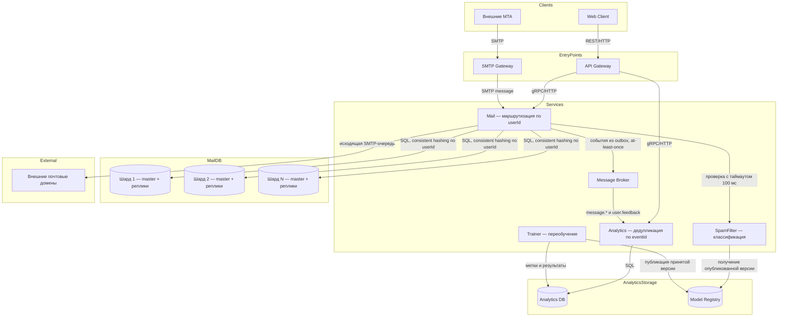
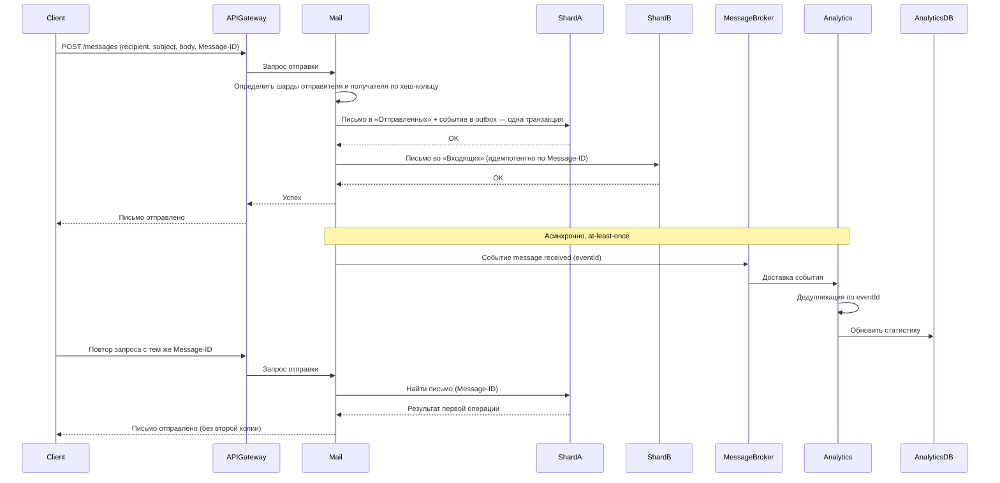
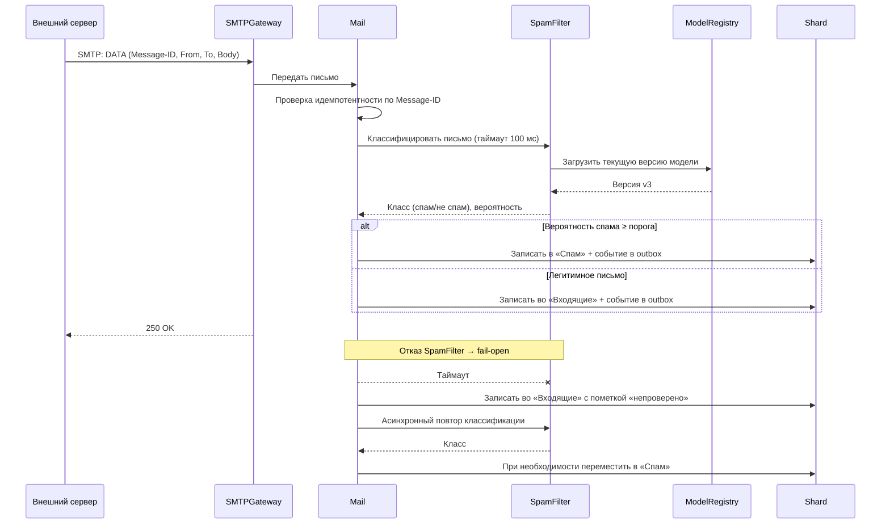
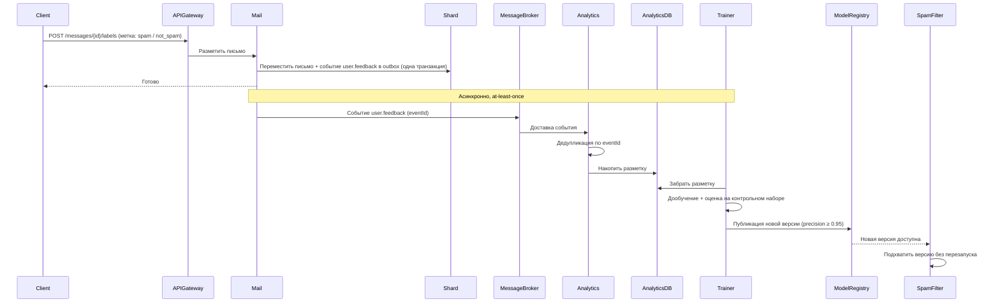
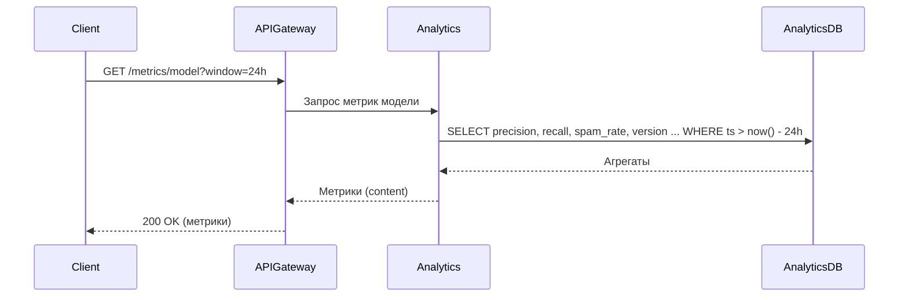
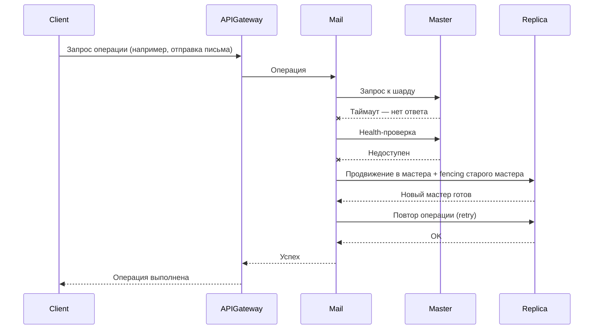
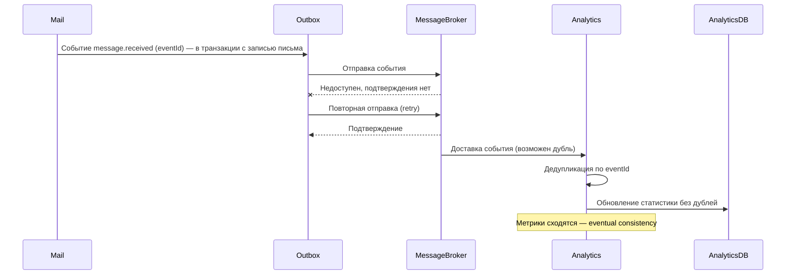

# Техническое решение проекта «Почтовый сервер с защитой от спама»

## Введение

- **Краткое описание:**  
  «Почтовый сервер с защитой от спама» — учебный проект, реализующий прототип распределённой почтовой системы с ML-классификацией входящих писем. Система позволяет отправлять и получать письма по протоколу SMTP, читать почту через веб-интерфейс, автоматически отделять спам от легитимных писем с помощью ML-модели и наблюдать качество модели через панель метрик. Обратная связь пользователей («спам» / «не спам») используется для периодического переобучения модели. Проект демонстрирует ключевые принципы построения отказоустойчивых и масштабируемых распределённых приложений.

- **Цель проекта:**  
  реализовать прототип распределённой почтовой системы, которая доставляет письма пользователям и автоматически фильтрует спам с помощью ML-модели.

- **Задачи:**  
  закрепить теоретические основы распределённых систем (масштабируемость, отказоустойчивость, консистентность) через практическую реализацию; продемонстрировать применение концепций курса: ненадёжная доставка сообщений, частичные отказы, распределение данных и нагрузки, модели согласованности, а также интеграцию ML-модели в распределённый конвейер обработки данных.

- **Состав команды:**  
  Иванов Кирилл(Тимлид, ML-инженер), Шестаков Алексей(Разработчик, тестировщик), Дозмолин Никита(Разработчик), Дегтярев Евгений (Тестировщик)

---

## Глоссарий
| Термин        | Определение |
|---------------|-------------|
| Почтовый ящик | Учётная запись пользователя, хранящая входящие и исходящие письма. |
| Письмо        | Сообщение с заголовками (From, To, Subject, Message-ID) и телом; единица хранения и доставки. |
| Message-ID    | Уникальный идентификатор письма, назначаемый при отправке; используется для дедупликации доставки одного письма, но не определяет, являются ли два запроса одной операцией отправки. |
| SMTP          | Протокол передачи почты между серверами (RFC 5321) и от клиента к серверу. |
| MX-запись     | DNS-запись, указывающая, какой сервер принимает почту для домена. |
| Папка         | Логическое хранилище писем в ящике: «Входящие», «Спам», «Отправленные», «Корзина». |
| Спам         | Нежелательная массовая рассылка, которую система должна не доставлять в «Входящие». |
| ML-модель     | Классификатор текста писем (спам / не спам), используемый для фильтрации. |
| Инференс      | Процесс применения обученной модели к новому письму для получения предсказания. |
| Обратная связь | Действие пользователя «пометить как спам» / «не спам» — разметка для переобучения. |
| Precision / Recall | Метрики качества классификатора: доля предсказанного спама, который реально спам, и доля реального спама, который модель нашла. |
| Model Registry | Хранилище версий обученных моделей; инференс работает с опубликованной версией. |
| API Gateway   | Точка входа для всех клиентских запросов веб-интерфейса. |
| Шард          | Независимый сегмент данных, размещённый на отдельном узле или группе узлов. |
| Хеш-кольцо    | Способ распределения ключей по узлам (consistent hashing): узлы и ключи отображаются хеш-функцией на кольцо, ключ принадлежит ближайшему узлу по часовой стрелке. |
| Виртуальный узел | Дополнительная точка хеш-кольца, принадлежащая физическому узлу; повышает равномерность распределения ключей. |
| Мастер        | Реплика, принимающая записи в пределах своего шарда. |
| Failover      | Автоматическое переключение на резервный узел при отказе основного. |
| Fencing       | Изоляция отказавшего мастера, исключающая его дальнейшие записи (защита от split-brain). |
| Идемпотентность | Свойство операции: повтор того же запроса с тем же ключом операции (например, после потери ответа) не создаёт новый эффект. Одинаковые получатель, тема и текст сами по себе не означают одну операцию: две намеренные отправки остаются двумя письмами. |
| Ключ операции | Идентификатор конкретного запроса пользователя, позволяющий распознать его повтор после потери ответа; для новой намеренной отправки создаётся новый ключ. |
| At-least-once | Семантика доставки сообщений: сообщение доставляется как минимум один раз, возможны дубли. |
| Transactional outbox | Паттерн: событие записывается в outbox-таблицу в той же транзакции, что и изменение данных, затем пересылается в брокер с повторами. |
| Event-ID | Уникальный идентификатор факта изменения или действия (например, пометки письма как «Спам» или «Не спам»); отличается от идентификатора письма. Последовательные пометки одного письма «Спам», затем «Не спам» — два разных события |
| Дедупликация  | Отбрасывание повторно доставленных копий одного события по идентификатору события; разные события для одного письма не отбрасываются. |
| Eventual consistency | Модель согласованности: при отсутствии новых обновлений все копии данных со временем сходятся к одному состоянию. |
| Fail-open     | Поведение системы при отказе ML-сервиса: письмо доставляется без классификации (помечается «непроверено»), фильтрация не блокирует почту. |

---

## Функциональные требования
Система должна предоставлять следующие функции:
1. Отправка писем пользователям внутри системы и на внешние почтовые домены по SMTP.  
2. Приём входящих писем по SMTP от внешних серверов и от внутренних пользователей.  
3. Просмотр и управление почтой через веб-интерфейс: папки «Входящие», «Спам», «Отправленные», «Корзина», чтение писем, удаление и перемещение.  
4. Автоматическая ML-классификация каждого входящего письма с перемещением спама в папку «Спам».  
5. Разметка писем пользователем («пометить как спам» / «не спам») с последующим использованием разметки для переобучения модели.  
6. Пользовательская отметка доминирует над системной отметкой, т.е., если пользователь отмечает письмо как "не спам"(или наоборот, "спам"), оно остаётся в соответственном разделе и не может быть перемещено в иную системой, а лишь будет использовано для дальнейшего переобучения модели.
7. Панель метрик ML-модели: precision, recall, доля спама в потоке, распределение предсказаний, качество по версиям модели.  

### Ограничения на предметную область

1. Почта работает только в пределах одного домена (например, `mail.example`); доставка на внешние домены выполняется по стандартному SMTP, но приём от внешних серверов не аутентифицируется через SPF/DKIM/DMARC — эти проверки вне объёма проекта.
2. Поддерживаются только текстовые письма и вложения размером не более 20 МБ.
3. Модель классифицирует только заголовок и текст письма; вложения не анализируются.
4. Пользовательские ящики создаются администратором, самообслуживающая регистрация вне объёма проекта.

---

## Нефункциональные требования

1. **Сохранность результата отправки:** повтор того же запроса отправки с тем же ключом операции (например, после потери ответа) не создаёт вторую копию в папках пользователя. Намеренная новая отправка с теми же получателем, темой и текстом создаёт отдельное письмо с новым `Message-ID`. Уже подтверждённое системой письмо и его метаданные не теряются при отказе узла хранения; после восстановления пользователь видит тот же результат отправки и может повторить запрос без создания дубликата.
2. **Отказоустойчивость:** система должна продолжать работать при сбое одного из узлов: недоступность обнаруживается по таймаутам и health-проверкам; при отказе мастера шарда система сама переключается на доступную реплику (failover); при отказе ML-сервиса почта продолжает доставляться (fail-open), письмо всё равно появляется во «Входящих» с отметкой «непроверено».
3. **Доставка событий:** семантика at-least-once; повторная доставка того же события не приводит к его повторной обработке (идемпотентность потребителя), но разные события для одного письма обрабатываются независимо. 
4. **Качество классификации:** показатели модели оцениваются на подготовленном контрольном наборе с заранее известными правильными метками (спам / легитимное письмо). На этом наборе precision должен быть не ниже 0,95, а доля ложных срабатываний — не выше 0,02. Доля ложных срабатываний определяется как доля легитимных писем, ошибочно классифицированных как спам: FP / (FP + TN).
Для писем, отобранных за выбранный период наблюдения, precision и recall рассчитываются только по письмам с известной правильной меткой, включая подтверждённую пользовательскую разметку. Неразмеченные письма исключаются из расчёта precision и recall, но отображаются отдельно как количество или доля неразмеченных писем.
5. **Понятность интерфейса:** результат каждой операции пользователя однозначно отображается в веб-интерфейсе: письмо отправлено, принято, перемещено, удалено или операция отклонена с объяснением причины.
6. **Работа при отказе узла хранения:** при отказе узла хранения пользователь не может выполнять операции, требующие недоступных данных, и получает понятное сообщение о временной недоступности. После восстановления доступа уже подтверждённые письма, папки и пользовательские отметки доступны в прежнем состоянии; подтверждённые письма не удаляются и не создаются повторно.
7. **Консистентность:** одно письмо не доставляется дважды при повторных SMTP-сессиях и повторной доставке одного события (дедупликация по `Message-ID` письма и идентификатору события соответственно); при отсутствии новых операций папки и метрики сходятся к полному состоянию (eventual consistency).  
8. **Восстановление статистики после сбоев доставки событий:** после прекращения новых операций и восстановления доставки событий панель метрик учитывает все сохранённые события, включая накопившиеся во время сбоя, ровно один раз по каждому идентификатору события. Повторная доставка дублей не изменяет итоговые показатели.

---

## Пользовательские сценарии

### Сценарий: отправка письма

**Участник:** авторизованный пользователь.

1. Пользователь открывает форму создания письма.
2. Пользователь указывает получателя, тему и текст письма и нажимает «Отправить».
3. Система сообщает об успешной отправке и показывает письмо в папке «Отправленные».
4. После классификации письма получатель видит его в папке «Входящие», если оно классифицировано как обычное, или в папке «Спам», если оно классифицировано как спам.
5. Если ответ на отправку потерян, пользователь повторяет тот же запрос с тем же ключом операции: система не создаёт дубликат и показывает ранее полученный результат. Две намеренные отправки с одинаковыми получателем, темой и текстом являются отдельными письмами.

### Сценарий: получение и автоматическая сортировка письма

**Участник:** внешний отправитель и получатель почты.

1. Внешний отправитель отправляет письмо на адрес пользователя.
2. Получатель открывает интерфейс и просматривает папки «Входящие» и «Спам».
3. Система помещает обычное письмо во «Входящие», а подозрительное письмо — в «Спам».
4. Пользователь открывает письмо и читает его содержимое.
5. Если проверка письма временно недоступна, система показывает письмо во «Входящих» с отметкой «непроверено», не блокируя его получение.

### Сценарий: изменение пользователем результата фильтрации

**Участник:** получатель почты.

1. Пользователь открывает письмо в папке «Спам» и нажимает «Не спам».
2. Система перемещает письмо во «Входящие» и сообщает об изменении.
3. Пользователь открывает ошибочно классифицированное письмо во «Входящих» и нажимает «Спам».
4. Система перемещает письмо в «Спам» и сообщает об изменении.
5. После запуска переобучения пользователь видит в панели метрик новую версию модели и её показатели.

### Сценарий: просмотр показателей классификации

**Участник:** пользователь с доступом к панели метрик.

1. Пользователь открывает панель метрик и выбирает либо подготовленный контрольный набор для оценки нормативного качества модели, либо период наблюдения для анализа размеченных писем.
2. Для контрольного набора система отображает `precision`, `recall` и долю ложных срабатываний. Для выбранного периода система отображает эти показатели только по письмам с известными правильными метками, а также отдельно показывает количество размеченных и неразмеченных писем.
3. Пользователь сравнивает показатели разных версий и проверяет, достигнуто ли установленное пороговое значение качества.

---

## Архитектура системы

Система построена как набор сервисов, взаимодействующих синхронно через API Gateway и асинхронно через Message Broker. Синхронный контур отвечает за приём пользовательских запросов и SMTP-сообщений, а асинхронный контур — за сбор аналитики, обучение моделей и обработку повторных классификаций.

Основные компоненты:

1. **Web Client** — веб-интерфейс пользователя для работы с папками, письмами, пользовательскими метками и панелью метрик.
2. **SMTP Gateway** — принимает входящие SMTP-сессии от внешних серверов и внутренних клиентов, выполняет базовый разбор письма и передаёт его в Mail.
3. **API Gateway** — единая точка входа для запросов веб-клиента; выполняет маршрутизацию в Mail и Analytics, а также возвращает клиенту однозначный результат операции.
4. **Mail** — основной сервис почтовой системы. Он обрабатывает отправку и приём писем, проверяет ключ операции и `Message-ID`, выбирает шард по `userId`, управляет папками, применяет пользовательские метки и записывает события в transactional outbox.
5. **SpamFilter** — синхронно классифицирует входящее письмо по заголовку и тексту с таймаутом 100 мс. При недоступности сервиса используется fail-open: письмо сначала помещается во «Входящие» с отметкой «непроверено», после чего классификация повторяется асинхронно.
6. **Model Registry** — хранит опубликованные версии ML-моделей. SpamFilter использует опубликованную версию и подхватывает новую без перезапуска.
7. **Message Broker** — передаёт события из transactional outbox в Analytics и другие асинхронные обработчики с семантикой at-least-once.
8. **Analytics** — потребляет события, дедуплицирует их по `eventId`, рассчитывает метрики и предоставляет данные для панели мониторинга.
9. **Analytics DB** — аналитическое хранилище событий, пользовательских меток, результатов классификации и метрик по версиям моделей.
10. **Trainer** — периодически получает подтверждённые пользовательские метки, дообучает модель и проверяет её на контрольном наборе. Версия публикуется в Model Registry только при выполнении требований к качеству.
11. **Mail DB** — транзакционное шардированное хранилище писем, папок, пользовательских меток, ключей операций и outbox-событий. Каждый шард имеет мастер и реплики.
12. **DNS/MX и внешние MTA** — обеспечивают маршрутизацию внешней почты на SMTP Gateway и отправку писем во внешние домены по SMTP.

### Шардирование и репликация Mail DB

- **Проблема:** объём писем и нагрузка на операции с почтой растут, а отказ одного узла не должен приводить к потере подтверждённых писем.
- **Решение:** Mail маршрутизирует данные по `userId` через consistent hashing с виртуальными узлами. Внутри каждого шарда записи принимает мастер, а реплики следуют за его журналом. При отказе мастера система по таймауту и health-проверке продвигает реплику, выполняет fencing старого мастера и повторяет операцию к новому мастеру.
- **Гарантия:** при добавлении или удалении узла перемещается только часть ключей; при отказе мастера подтверждённые письма, папки и пользовательские метки сохраняются на репликах и остаются доступными после failover.
- **Компромиссы:** репликация увеличивает стоимость хранения и задержку подтверждения записи; операции, затрагивающие ящики разных пользователей, требуют координации между шардами.

### Доставка событий и идемпотентность

- **Проблема:** брокер или соединение с ним может временно отказать, а повторная доставка события может создать дубликат аналитических данных.
- **Решение:** событие записывается в outbox в одной транзакции с изменением Mail DB и отправляется в Message Broker с повторами до подтверждения. Mail различает ключ операции, `Message-ID` письма и `eventId`: повтор запроса с тем же ключом операции не создаёт второе письмо, повтор одного SMTP-события не создаёт вторую доставку, а Analytics дедуплицирует повторно доставленные события по `eventId`.
- **Гарантия:** применяется at-least-once без потери сохранённых событий; повторная обработка одного события не меняет итоговые метрики, а разные события для одного письма обрабатываются независимо. После восстановления доставки аналитика сходится к полному состоянию.
- **Компромиссы:** метрики могут временно отставать от состояния Mail DB, зато отказ брокера не приводит к потере событий.

### Контур ML-классификации и переобучения

- **Синхронный путь:** Mail передаёт входящее письмо в SpamFilter. При успешном ответе письмо помещается в «Спам» или «Входящие» в зависимости от вероятности; результат классификации и событие записываются транзакционно. При таймауте письмо доставляется во «Входящие» как «непроверенное».
- **Асинхронный путь:** повторная классификация непроверенных писем, пользовательские события `user.feedback` и события доставки поступают через Message Broker в Analytics. Пользовательская метка имеет приоритет над системным предсказанием и запрещает автоматическое перемещение письма в другую папку.
- **Обучение:** Trainer получает накопленные метки, обучает новую версию и проверяет её на контрольном наборе. В Model Registry публикуется только версия, достигшая `precision >= 0.95` и остальных установленных ограничений качества; SpamFilter затем переключается на неё без остановки сервиса.

### Обработка частичных отказов

- SMTP Gateway подтверждает приём письма только после того, как Mail сохранил его результат в Mail DB; недоступность SpamFilter не блокирует доставку благодаря fail-open.
- При временной недоступности Message Broker outbox сохраняет события до успешной повторной отправки.
- При отказе узла Mail DB операции, требующие недоступных данных, отклоняются с понятным сообщением, а уже подтверждённые данные восстанавливаются после failover.
- Таймауты, health-проверки, retry и fencing используются совместно: retry применяется для временных ошибок, failover — для подтверждённого отказа мастера, а fencing предотвращает записи старого узла и split-brain.

### Модели согласованности

- Mail DB является источником истины для писем, папок и пользовательских меток; операции изменения выполняются транзакционно.
- Для одного письма дедупликация доставки выполняется по `Message-ID`, для событий — по `eventId`, а пользовательские запросы отправки повторяются идемпотентно по ключу операции.
- Analytics DB обновляется асинхронно и допускает eventual consistency: после прекращения новых операций и восстановления доставки событий показатели сходятся к состоянию всех сохранённых событий без дублей.

---

## Технические сценарии

### Сценарий: отправка письма внутри системы

1. Клиент отправляет в API Gateway запрос POST /messages с параметрами: recipient, subject, body и идемпотентный ключ (Message-ID, генерируется клиентом).
2. API Gateway перенаправляет запрос в сервис Mail.
3. Инстанс Mail по локальной копии хеш-кольца определяет шарды отправителя и получателя (хеш от userId).
4. В одной транзакции на шарде отправителя письмо записывается в папку «Отправленных», на шарде получателя — в папку «Входящих» (за исключением внешнего получателя — тогда исходящая очередь), и в outbox-таблицу записывается событие message.received.
5. Mail сообщает API Gateway об успешной отправке, API Gateway возвращает клиенту ответ.
6. Асинхронно: событие из outbox пересылается в Message Broker (at-least-once); Analytics дедуплицирует его по eventId и обновляет Analytics DB.
7. Повторный запрос с тем же Message-ID: Mail находит существующее письмо и возвращает результат первой операции без второй копии.

### Сценарий: приём входящего письма и классификация спама

1. Внешний почтовый сервер отправляет письмо по SMTP на SMTP Gateway (MX-запись домена).
2. SMTP Gateway передаёт письмо в сервис Mail; Mail проверяет Message-ID на идемпотентность.
3. Mail вызывает SpamFilter с таймаутом 100 мс; SpamFilter выполняет инференс опубликованной моделью из Model Registry и возвращает класс и вероятность.
4. Если вероятность спама выше порога — письмо записывается в папку «Спам», иначе — во «Входящие»; в той же транзакции в outbox пишется событие message.classified.
5. Если SpamFilter не ответил за таймаут — письмо доставляется во «Входящие» с пометкой «непроверено» (fail-open), а асинхронный повтор классификации при результате перемещает письмо в «Спам».
6. SMTP Gateway отвечает внешнему серверу 250 OK — письмо принято.

### Сценарий: обратная связь пользователя и переобучение модели

1. Пользователь открывает письмо в папке «Спам» и нажимает «Не спам» (или наоборот — «Спам» во «Входящих»).
2. Клиент отправляет в API Gateway запрос POST /messages/{messageId}/labels с меткой.
3. API Gateway перенаправляет запрос в Mail; Mail перемещает письмо в нужную папку и в одной транзакции записывает событие user.feedback в outbox.
4. Событие доставляется в Message Broker (at-least-once), Analytics дедуплицирует его по eventId и накапливает разметку в Analytics DB.
5. По расписанию Trainer забирает разметку из Analytics DB, дообучает модель и оценивает её на контрольном наборе.
6. Если метрики прошли приёмку (precision ≥ 0.95) — Trainer публикует версию в Model Registry; SpamFilter подхватывает её без перезапуска.

### Сценарий: просмотр панели метрик ML-модели

1. Пользователь открывает страницу метрик, отправляя GET /metrics/model?window=24h.
2. API Gateway перенаправляет запрос в сервис Analytics.
3. Analytics выполняет агрегирующие запросы к Analytics DB: precision/recall за окно, долю спама во входящем потоке, распределение предсказаний по версиям модели.
4. API Gateway возвращает клиенту ответ со списком метрик.

### Сценарий: отказ мастера шарда

1. Во время обработки запросов мастер одного из шардов Mail DB перестаёт отвечать.
2. Инстанс Mail не получает ответ в течение таймаута и проверяет узел health-запросом; мастер недоступен.
3. Система продвигает реплику шарда в новый мастер и изолирует старый мастер (fencing), исключающий его записи.
4. Инстанс Mail повторяет операцию к новому мастеру (retry).
5. Клиентская операция завершается успешно; задержка ограничена временем детекции и переключения.

### Сценарий: потеря и повторная доставка события

1. После доставки письма событие message.received записано в outbox-таблицу шарда.
2. Message Broker временно недоступен — отправка события не подтверждается.
3. Отправитель outbox повторяет отправку до подтверждения — семантика at-least-once.
4. В результате брокер может доставить событие в Analytics более одного раза.
5. Analytics распознаёт повтор по eventId (дедупликация) и отбрасывает дубликат.
6. Метрики сходятся к полному состоянию без дублей — eventual consistency.

## План разработки и тестирования

План рассчитан на команду до четырёх человек. Все сервисы должны запускаться локально или на доступных учебных устройствах; для демонстрации не требуются отдельные облачные кластеры, настоящие внешние почтовые домены или промышленная ML-инфраструктура. Внешний SMTP и брокер сообщений допускается заменить локальными тестовыми заглушками или контейнерами.

**Включает:**

- реализацию API Gateway и минимального веб-интерфейса;
- реализацию сервиса Mail для отправки, приёма, чтения, перемещения и удаления текстовых писем;
- реализацию SMTP Gateway для демонстрации приёма письма;
- хранение писем, папок, пользовательских меток и ключей идемпотентности в транзакционной базе данных;
- простую ML-модель или воспроизводимый учебный классификатор спама с версией модели;
- интеграцию Message Broker или его локальной учебной реализации для событий;
- реализацию transactional outbox и дедупликации событий в Analytics;
- панель основных метрик: `precision`, `recall`, доля спама и число неразмеченных писем;
- демонстрацию отказа SpamFilter и повторной классификации письма;
- демонстрацию ограниченного failover на локальной копии базы или заранее подготовленном тестовом стенде.

**План разработки:**

1. Уточнить форматы данных и API для писем, папок, пользовательских меток и метрик. Зафиксировать сценарии демонстрации.
2. Реализовать транзакционную модель Mail DB: пользователи, письма, папки, `Message-ID`, ключи операций, пользовательские метки и outbox.
3. Реализовать сервис Mail: отправка и приём писем, проверка повторного запроса, работа с папками и приоритет пользовательской метки над системной классификацией.
4. Реализовать API Gateway и минимальные страницы веб-интерфейса для списка папок, просмотра письма, отправки и разметки «Спам» / «Не спам».
5. Реализовать SMTP Gateway и локальный сценарий приёма входящего письма без подключения к настоящей DNS/MX-инфраструктуре.
6. Реализовать SpamFilter на небольшой заранее подготовленной текстовой выборке. Добавить версионирование модели и таймаут вызова.
7. Добавить Message Broker или локальную очередь, публикацию событий из outbox и повторную отправку неподтверждённых событий.
8. Реализовать Analytics: дедупликацию по `eventId`, накопление пользовательских меток и расчёт метрик по контрольному набору и выбранному периоду.
9. Реализовать Trainer в упрощённом виде: запуск переобучения по команде или расписанию, проверка порогов качества и публикация новой версии модели.
10. Добавить учебную демонстрацию отказов: недоступность SpamFilter, задержка брокера и переключение на подготовленную реплику хранилища.
11. Подготовить README с командами запуска, тестовыми пользователями, примерами запросов и последовательностью демонстрации.

Работу можно распределить по четырём устройствам(участникам) следующим образом:

1. **Почтовый контур:** Mail, Mail DB, папки и идемпотентность.
2. **Клиентский и SMTP-контур:** API Gateway, веб-интерфейс и SMTP Gateway.
3. **ML-контур:** SpamFilter, Model Registry и Trainer.
4. **Событийный и аналитический контур:** Message Broker, outbox, Analytics и метрики.

Интеграцию следует выполнять поэтапно: сначала запустить Mail с базой и API, затем добавить классификацию, после этого — события и Analytics. Каждый участник предоставляет локальный способ запуска своей части, а перед финальной демонстрацией все сервисы проверяются в едином сценарии.

**План тестирования:**

- модульные тесты Mail для создания письма, перемещения между папками и удаления;
- модульные тесты идемпотентности: повтор запроса с тем же ключом операции не создаёт второе письмо, а новая отправка с новым ключом создаёт отдельное письмо;
- тест дедупликации по `Message-ID` при повторном приёме одного SMTP-сообщения;
- тесты API Gateway для корректных и некорректных запросов, несуществующего письма и недоступной операции;
- интеграционный тест записи письма и события outbox в одной транзакции;
- тест повторной отправки события после временной недоступности Message Broker;
- тест дедупликации: повторная доставка одного `eventId` не изменяет метрики дважды;
- тест SpamFilter на небольшом контрольном наборе с проверкой `precision >= 0.95` и доли ложных срабатываний `<= 0.02`, если размер учебного набора позволяет получить статистически осмысленный результат;
- тест пользовательской метки: после отметки «Спам» или «Не спам» автоматическая классификация не перемещает письмо вопреки этой метке;
- тест fail-open: при недоступности SpamFilter письмо появляется во «Входящих» с отметкой «непроверено», а после восстановления классифицируется повторно;
- тест SMTP Gateway на приём письма и отображение его в правильном ящике;
- тест расчёта метрик: размеченные письма входят в `precision` и `recall`, неразмеченные показываются отдельно;
- демонстрационный тест восстановления после сбоя брокера: накопившиеся события доставляются после восстановления, а итоговые метрики сходятся без дублей;
- демонстрационный тест переключения на заранее подготовленную реплику хранилища с сохранением подтверждённого письма;
- ручная проверка полного пользовательского сценария: отправка, получение, классификация, чтение, перемещение, удаление и просмотр метрик.

**Definition of Done (DoD):**

- локально запускаются все необходимые сервисы не более чем на четырёх доступных устройствах;
- пользователь может отправить письмо, увидеть его в «Отправленных» и получить его в нужной папке;
- повтор отправки с тем же ключом операции не создаёт дубликат;
- повторный приём одного SMTP-сообщения не создаёт второе письмо;
- письмо срабатывает на учебном классификаторе и при отказе SpamFilter не теряется;
- пользовательская отметка сохраняется и имеет приоритет над автоматической классификацией;
- событие, повторно доставленное в Analytics, не создаёт дубль в статистике;
- панель показывает метрики по контрольному набору и отдельно количество неразмеченных писем;
- после восстановления брокера сохранённые события обрабатываются, а статистика сходится к ожидаемым значениям;
- подготовленный сценарий failover показывает сохранение ранее подтверждённого письма;
- автоматические тесты проходят, а README содержит команды запуска и сценарий итоговой демонстрации.
