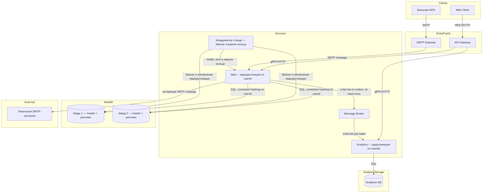
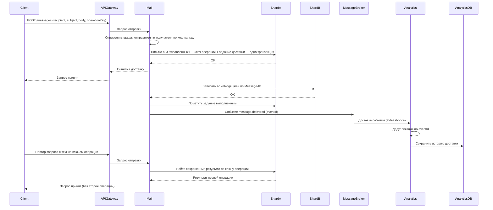
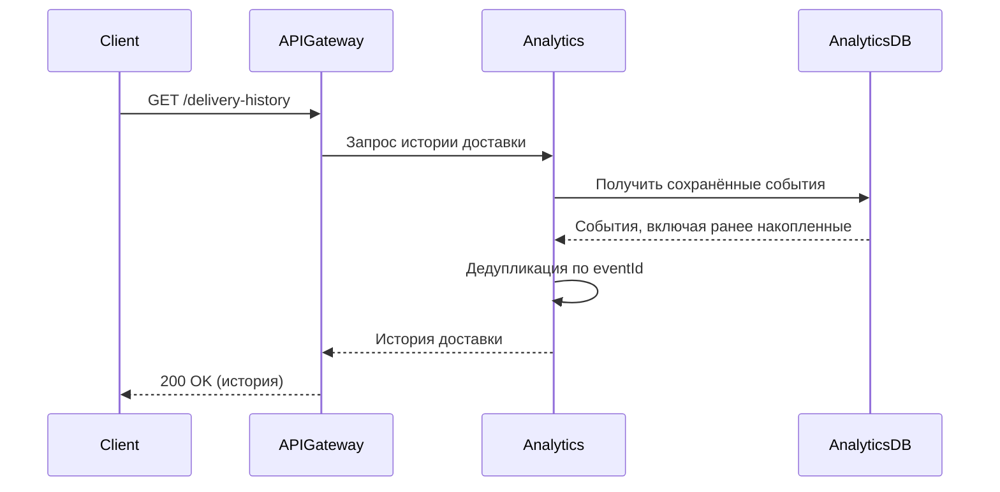
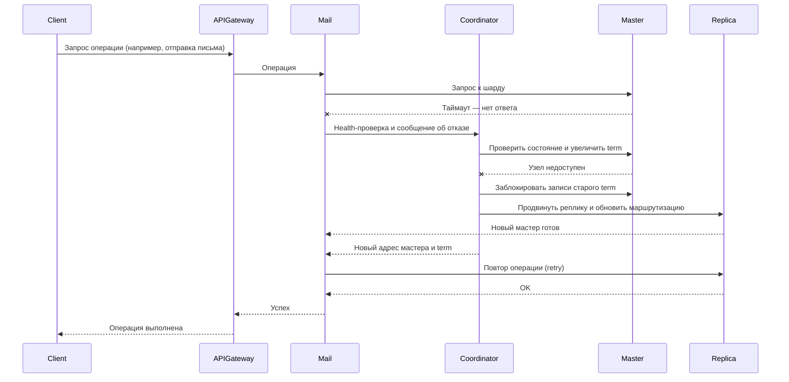
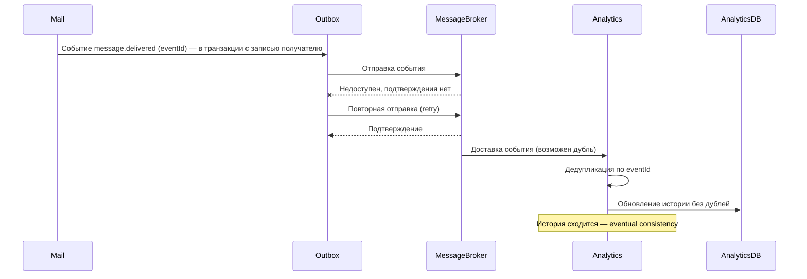

# Техническое решение проекта «Почтовый сервер»

## Введение

- **Краткое описание:**  
  «Почтовый сервер» — учебный проект, реализующий прототип распределённой почтовой системы. Система позволяет отправлять и получать письма по протоколу SMTP, читать почту и управлять письмами через веб-интерфейс. Проект демонстрирует ключевые принципы построения отказоустойчивых и масштабируемых распределённых приложений.

- **Цель проекта:**  
  реализовать прототип распределённой почтовой системы, которая доставляет письма пользователям и сохраняет их в соответствующих папках.

- **Задачи:**  
  закрепить теоретические основы распределённых систем (масштабируемость, отказоустойчивость, консистентность) через практическую реализацию; продемонстрировать применение концепций курса: ненадёжная доставка сообщений, частичные отказы, распределение данных и нагрузки, модели согласованности и интеграцию сервисов в распределённый конвейер обработки данных.

- **Состав команды:**  
  Иванов Кирилл (Тимлид), Шестаков Алексей (Разработчик, тестировщик), Дозмолин Никита (Разработчик), Дегтярев Евгений (Тестировщик)

---

## Глоссарий
| Термин        | Определение |
|---------------|-------------|
| Почтовый ящик | Учётная запись пользователя, хранящая входящие и исходящие письма. |
| Письмо        | Сообщение с заголовками (From, To, Subject, Message-ID) и телом; единица хранения и доставки. |
| Message-ID    | Уникальный идентификатор письма, назначаемый при отправке; используется для дедупликации доставки одного письма, но не определяет, являются ли два запроса одной операцией отправки. Для входящего SMTP повтор без Message-ID определяется по ограниченному составному отпечатку сообщения и получателя. |
| SMTP          | Протокол передачи почты между серверами (RFC 5321) и от клиента к серверу. |
| MX-запись     | DNS-запись, указывающая, какой сервер принимает почту для домена. |
| Папка         | Логическое хранилище писем в ящике: «Входящие», «Отправленные», «Корзина». |
| API Gateway   | Точка входа для всех клиентских запросов веб-интерфейса. |
| Шард          | Независимый сегмент данных, размещённый на отдельном узле или группе узлов; в учебном стенде шардирование выполняется по `userId`. |
| Хеш-кольцо    | Способ распределения ключей по узлам (consistent hashing): узлы и ключи отображаются хеш-функцией на кольцо, ключ принадлежит ближайшему узлу по часовой стрелке. |
| Виртуальный узел | Дополнительная точка хеш-кольца, принадлежащая физическому узлу; повышает равномерность распределения ключей. |
| Мастер        | Реплика, принимающая записи в пределах своего шарда. |
| Failover      | Автоматическое переключение на резервный узел при отказе основного. |
| Fencing       | Изоляция отказавшего мастера, исключающая его дальнейшие записи (защита от split-brain). |
| Идемпотентность | Свойство операции: повтор того же запроса с тем же ключом операции (например, после потери ответа) не создаёт новый эффект. Одинаковые получатель, тема и текст сами по себе не означают одну операцию: две намеренные отправки остаются двумя письмами. |
| Ключ операции | Идентификатор конкретного запроса пользователя, позволяющий распознать его повтор после потери ответа; для новой намеренной отправки создаётся новый ключ. |
| Задание доставки | Надёжно сохранённая запись о необходимости передать письмо на шард получателя; обрабатывается с повторами и помечается выполненной только после успешной записи. |
| At-least-once | Семантика доставки сообщений: сообщение доставляется как минимум один раз, возможны дубли. |
| Transactional outbox | Паттерн: событие записывается в outbox-таблицу в той же транзакции, что и изменение данных, затем пересылается в брокер с повторами. |
| Message Broker | Посредник для асинхронной передачи событий между сервисами; может доставить одно событие более одного раза. |
| Event-ID    | Уникальный идентификатор факта изменения или действия; отличается от идентификатора письма и ключа операции. |
| Дедупликация  | Отбрасывание повторно доставленных копий одного события по идентификатору события; разные события для одного письма не отбрасываются. |
| Координатор стенда | Компонент учебного стенда, который выполняет health-проверки узлов, выбирает реплику при failover и распространяет актуальные маршруты и поколение шарда. |
| Health-проверка | Периодический или выполняемый после таймаута запрос, проверяющий доступность и готовность узла принимать операции. |
| Поколение шарда (`term`) | Монотонно увеличиваемый номер текущего владельца шарда; запись со старым поколением отклоняется, чтобы изолированный мастер не продолжал изменять данные. |
| Eventual consistency | Модель согласованности: при отсутствии новых обновлений все копии данных со временем сходятся к одному состоянию. |

---

## Функциональные требования
Система должна предоставлять следующие функции:
1. Отправка писем пользователям внутри системы и на внешние почтовые домены по SMTP.  
2. Приём входящих писем по SMTP от внешних серверов и от внутренних пользователей.  
3. Просмотр и управление почтой через веб-интерфейс: папки «Входящие», «Отправленные», «Корзина», чтение писем, удаление и перемещение.  

### Ограничения на предметную область

1. Почта работает только в пределах одного домена (например, `mail.example`); внешняя доставка демонстрируется через локальную SMTP-заглушку, а настоящие внешние домены и аутентификация SPF/DKIM/DMARC находятся вне объёма проекта.
2. Поддерживаются только текстовые письма.
3. Пользовательские ящики создаются администратором, самообслуживающая регистрация вне объёма проекта.

---

## Нефункциональные требования

1. **Сохранность результата отправки:** повтор того же запроса отправки с тем же ключом операции (например, после потери ответа) не создаёт вторую копию в папках пользователя. Намеренная новая отправка с теми же получателем, темой и текстом создаёт отдельное письмо с новым `Message-ID`. Уже подтверждённое системой письмо и его метаданные не теряются при отказе узла хранения; после восстановления пользователь видит тот же результат отправки и может повторить запрос без создания дубликата.
2. **Отказоустойчивость:** система должна продолжать работать при сбое одного из узлов: недоступность обнаруживается по таймаутам и health-проверкам; при отказе мастера шарда система сама переключается на доступную реплику (failover).
3. **Доставка событий:** семантика at-least-once; повторная доставка того же события не приводит к его повторной обработке (идемпотентность потребителя), но разные события для одного письма обрабатываются независимо. 
4. **Понятность интерфейса:** результат каждой операции пользователя однозначно отображается в веб-интерфейсе: письмо отправлено, принято, перемещено, удалено или операция отклонена с объяснением причины.
5. **Работа при отказе узла хранения:** при отказе узла хранения пользователь не может выполнять операции, требующие недоступных данных, и получает понятное сообщение о временной недоступности. После восстановления доступа уже подтверждённые письма и папки доступны в прежнем состоянии; подтверждённые письма не удаляются и не создаются повторно.
6. **Консистентность:** одно письмо не доставляется дважды при повторных SMTP-сессиях и повторной доставке одного события (дедупликация по `Message-ID` письма и идентификатору события соответственно); при отсутствии новых операций состояние папок и история доставки сходятся к полному состоянию (eventual consistency).  
7. **Восстановление данных после сбоев доставки событий:** после прекращения новых операций и восстановления доставки событий Analytics учитывает все сохранённые события, включая накопившиеся во время сбоя, ровно один раз по каждому идентификатору события.

---

## Пользовательские сценарии

### Сценарий: отправка письма

**Участник:** авторизованный пользователь.

1. Пользователь открывает форму создания письма.
2. Пользователь указывает получателя, тему и текст письма и нажимает «Отправить».
3. Система сообщает об успешной отправке и показывает письмо в папке «Отправленные».
4. Получатель видит письмо в папке «Входящие».
5. Если ответ на отправку потерян, пользователь повторяет тот же запрос с тем же ключом операции: система не создаёт дубликат и показывает ранее полученный результат. Две намеренные отправки с одинаковыми получателем, темой и текстом являются отдельными письмами.

### Сценарий: получение письма

**Участник:** локальная SMTP-заглушка, имитирующая внешний отправитель, и получатель почты.

1. Локальная SMTP-заглушка открывает SMTP-сессию и имитирует внешний отправитель, отправляя письмо на адрес пользователя.
2. SMTP Gateway принимает письмо от заглушки и передаёт его в Mail.
3. Mail проверяет `Message-ID` в области конкретного ящика и помещает письмо во «Входящие». Если `Message-ID` отсутствует, Mail использует составной отпечаток заголовков и тела вместе с адресом получателя только для защиты от повтора этому получателю; такое письмо не считается глобально дедуплицированным для других получателей.
4. После успешного сохранения письма SMTP Gateway отвечает заглушке `250 OK`. Этот ответ означает, что письмо принято системой, но не является доказательством настоящей доставки во внешний домен.
5. Получатель открывает интерфейс и читает содержимое письма.

### Сценарий: управление письмами

**Участник:** получатель почты.

1. Пользователь открывает письмо во «Входящих».
2. Пользователь перемещает письмо в другую доступную папку или удаляет его.
3. Система сохраняет изменение и сообщает результат операции.

---

## Архитектура системы

Система построена как набор сервисов, взаимодействующих синхронно через API Gateway и асинхронно через Message Broker. Синхронный контур отвечает за приём пользовательских запросов и SMTP-сообщений, а асинхронный контур — за сбор аналитики и обработку событий доставки.

Основные компоненты:

1. **Web Client** — веб-интерфейс пользователя для работы с папками и письмами.
2. **SMTP Gateway** — принимает входящие SMTP-сессии от внешних серверов и внутренних клиентов, выполняет базовый разбор письма и передаёт его в Mail.
3. **API Gateway** — единая точка входа для запросов веб-клиента; выполняет маршрутизацию в Mail и Analytics, а также возвращает клиенту однозначный результат операции.
4. **Mail** — основной сервис почтовой системы. Он обрабатывает отправку и приём писем, проверяет ключ операции и `Message-ID`, выбирает шард по `userId`, управляет папками и записывает задания доставки и события в transactional outbox.
5. **Message Broker** — передаёт события из transactional outbox в Analytics с семантикой at-least-once.
6. **Analytics** — потребляет события и дедуплицирует их по `eventId`.
7. **Analytics DB** — хранит историю обработанных событий и агрегированные сведения о доставке.
8. **Mail DB** — транзакционное шардированное хранилище писем, папок, ключей операций, заданий межшардовой доставки и outbox-событий. Каждый шард имеет мастер и реплики.
9. **Координатор стенда** — выполняет health-проверки узлов, выбирает реплику при отказе мастера, увеличивает поколение шарда (`term`), блокирует записи старого мастера и распространяет Mail актуальную версию хеш-кольца и маршрутизации.
10. **Локальная SMTP-заглушка внешней доставки** — имитирует успешную передачу письма во внешний домен; настоящая внешняя SMTP-доставка не входит в учебный scope.

### Шардирование и репликация Mail DB

- **Проблема:** объём писем и нагрузка на операции с почтой растут, а отказ одного узла не должен приводить к потере подтверждённых писем.
- **Учебный стенд:** используются два физических узла, два логических шарда и по одной реплике каждого шарда. Шард и его реплика размещаются на разных узлах; хеш-кольцо содержит виртуальные узлы, принадлежащие логическим шардам, а ключами кольца являются `userId`.
- **Решение:** Mail маршрутизирует запрос по локальной версии кольца. Запись подтверждается только после сохранения на мастере и синхронной репликации на резервный узел. При отказе мастера локальный координатор стенда выбирает здоровую реплику, переводит её в режим записи и публикует новую версию таблицы маршрутизации; Mail обновляет адрес мастера по health-запросу.
- **Fencing:** старый мастер блокируется правилом доступа по текущему поколению шарда (`term`) и исключается из списка узлов, принимающих записи. Запрос со старым `term` отклоняется, поэтому изолированный узел не может продолжить запись.
- **Гарантия учебного стенда:** фиксированное кольцо из двух логических шардов маршрутизирует ящики по `userId`, а подтверждённые письма и папки сохраняются на репликах и остаются доступными после failover.
- **Компромиссы:** репликация увеличивает стоимость хранения и задержку подтверждения записи; операции, затрагивающие ящики разных пользователей, требуют координации между шардами.

### Доставка событий и идемпотентность

- **Проблема:** брокер или соединение с ним может временно отказать, а повторная доставка события может создать дубликат аналитических данных.
- **Решение:** событие записывается в outbox в одной транзакции с изменением Mail DB и отправляется в Message Broker с повторами до подтверждения. Mail различает ключ операции, `Message-ID` письма и `eventId`: повтор запроса с тем же ключом операции не создаёт второе письмо, повтор одного SMTP-события не создаёт вторую доставку, а Analytics дедуплицирует повторно доставленные события по `eventId`.
- **Гарантия:** применяется at-least-once без потери сохранённых событий; повторная обработка одного события не создаёт дубль в истории доставки. После восстановления доставки Analytics сходится к полному состоянию.
- **Компромиссы:** история доставки может временно отставать от состояния Mail DB, зато отказ брокера не приводит к потере событий.

### Обработка частичных отказов

- SMTP Gateway подтверждает приём письма только после того, как Mail сохранил его результат в Mail DB.
- При временной недоступности Message Broker outbox сохраняет события до успешной повторной отправки.
- При отказе узла Mail DB операции, требующие недоступных данных, отклоняются с понятным сообщением, а уже подтверждённые данные восстанавливаются после failover.
- Таймауты, health-проверки, retry и fencing используются совместно: retry применяется для временных ошибок, failover — для подтверждённого отказа мастера, а fencing предотвращает записи старого узла и split-brain.

### Модели согласованности

- Mail DB является источником истины для писем и папок; операции изменения выполняются транзакционно.
- Для одного письма дедупликация доставки выполняется по `Message-ID`, для событий — по `eventId`, а пользовательские запросы отправки повторяются идемпотентно по ключу операции.
- Analytics DB обновляется асинхронно и допускает eventual consistency: после прекращения новых операций и восстановления доставки событий история доставки сходится к состоянию всех сохранённых событий без дублей.

---

## Технические сценарии

### Сценарий: отправка письма внутри системы

1. Клиент отправляет в API Gateway запрос POST /messages с параметрами: recipient, subject, body и отдельный идемпотентный ключ операции. `Message-ID` создаётся Mail для нового письма.
2. API Gateway перенаправляет запрос в сервис Mail.
3. Инстанс Mail по локальной копии хеш-кольца определяет шарды отправителя и получателя (хеш от userId).
4. В локальной транзакции на шарде отправителя письмо записывается в папку «Отправленных», сохраняется ключ операции с результатом запроса и создаётся надёжное задание доставки получателю.
5. Mail сообщает API Gateway о принятии письма в доставку. Это подтверждение означает, что исходная копия и задание доставки сохранены; завершение доставки получателю отслеживается отдельно.
6. Фоновый обработчик заданий идемпотентно записывает письмо на шард получателя по `Message-ID`, повторяет попытки после ошибки и помечает задание выполненным только после успешной записи.
7. После записи получателю формируется событие `message.delivered` в outbox; оно пересылается в Message Broker (at-least-once), а Analytics дедуплицирует его по `eventId`.
8. Повтор запроса с тем же ключом операции возвращает сохранённый результат первой операции и не создаёт новое письмо. Новая намеренная отправка получает новый ключ операции и новый `Message-ID`.

### Сценарий: просмотр истории доставки

1. Пользователь открывает страницу истории в веб-интерфейсе.
2. API Gateway запрашивает у Analytics сведения о доставке писем.
3. Analytics возвращает историю после дедупликации событий.
4. Пользователь видит актуальную историю; при задержке брокера она дополняется после восстановления доставки событий.

### Сценарий: отказ мастера шарда

1. Во время обработки запросов мастер одного из шардов Mail DB перестаёт отвечать.
2. Инстанс Mail не получает ответ в течение таймаута и проверяет узел health-запросом; мастер недоступен.
3. Система продвигает реплику шарда в новый мастер и изолирует старый мастер (fencing), исключающий его записи.
4. Инстанс Mail повторяет операцию к новому мастеру (retry).
5. Клиентская операция завершается успешно; задержка ограничена временем детекции и переключения.

### Сценарий: потеря и повторная доставка события

1. После записи письма получателю событие message.delivered записано в outbox-таблицу шарда.
2. Message Broker временно недоступен — отправка события не подтверждается.
3. Отправитель outbox повторяет отправку до подтверждения — семантика at-least-once.
4. В результате брокер может доставить событие в Analytics более одного раза.
5. Analytics распознаёт повтор по eventId (дедупликация) и отбрасывает дубликат.
6. История доставки сходится к полному состоянию без дублей — eventual consistency.

## План разработки и тестирования

План рассчитан на команду до четырёх человек. Все сервисы должны запускаться локально или на доступных учебных устройствах; для демонстрации не требуются отдельные облачные кластеры и настоящие внешние почтовые домены. Внешний SMTP и брокер сообщений допускается заменить локальными тестовыми заглушками или контейнерами.

**Включает:**

- реализацию API Gateway и минимального веб-интерфейса;
- реализацию сервиса Mail для отправки, приёма, чтения, перемещения и удаления текстовых писем;
- реализацию SMTP Gateway для демонстрации приёма письма;
- хранение писем, папок и ключей идемпотентности в транзакционной базе данных;
- интеграцию Message Broker или его локальной учебной реализации для событий;
- реализацию transactional outbox и дедупликации событий в Analytics;
- простую историю доставки писем и агрегированные сведения о доставленных сообщениях;
- реализацию локального учебного стенда с фиксированным кольцом из двух логических шардов, репликами и автоматическим failover через координатор.

Локальные SMTP-клиент, внешняя SMTP-доставка и Message Broker допускается реализовать как учебные компоненты или контейнеры. Заглушка внешней доставки используется только для демонстрации интерфейса отправки и не считается настоящей доставкой во внешний домен. Для outbox, дедупликации, сохранения подтверждённых писем и failover используются работающие локальные компоненты стенда, а не заглушки, возвращающие заранее заданный успех.

**План разработки:**

1. Уточнить форматы данных и API для писем, папок и истории доставки. Зафиксировать сценарии демонстрации.
2. Реализовать транзакционную модель Mail DB: пользователи, текстовые письма, папки, `Message-ID`, ключи операций, задания доставки и outbox.
3. Реализовать сервис Mail: отправка и приём текстовых писем, проверка повторного запроса и работа с папками.
4. Реализовать API Gateway и минимальные страницы веб-интерфейса для списка папок, просмотра, отправки, перемещения и удаления писем.
5. Реализовать SMTP Gateway и локальный сценарий приёма входящего письма без подключения к настоящей DNS/MX-инфраструктуре.
6. Добавить Message Broker или локальную очередь, публикацию событий из outbox и повторную отправку неподтверждённых событий.
7. Реализовать Analytics: дедупликацию по `eventId` и историю доставки.
8. Реализовать учебный стенд Mail DB: фиксированное кольцо из двух логических шардов, по одной реплике каждого шарда на другом физическом узле, consistent hashing по `userId`, координатор, `term` и fencing.
9. Реализовать автоматический failover фиксированного кольца из двух шардов с обновлением маршрутизации Mail.
10. Добавить проверку задержки брокера и повторной доставки событий на работающем локальном брокере или учебной реализации очереди.
11. Подготовить README с командами запуска, тестовыми пользователями, примерами запросов, размещением сервисов на устройствах и последовательностью демонстрации; отдельно указать, что внешняя SMTP-доставка является заглушкой.

Работу можно распределить по четырём устройствам (участникам) следующим образом:

1. **Устройство 1:** Mail, API Gateway, Web Client и Mail DB с мастером первого шарда.
2. **Устройство 2:** реплика первого шарда, мастер второго шарда и координатор стенда.
3. **Устройство 3:** реплика второго шарда, SMTP Gateway и локальная SMTP-заглушка внешней доставки.
4. **Устройство 4:** Message Broker, Analytics и Analytics DB.

Координатор считается доступным постоянно; отказ самого координатора и восстановление его состояния не входят в учебный scope.

**План тестирования:**

- модульные тесты Mail для создания письма, перемещения между папками и удаления;
- модульные тесты идемпотентности: повтор запроса с тем же ключом операции не создаёт второе письмо, а новая отправка с новым ключом создаёт отдельное письмо;
- тест дедупликации по `Message-ID` при повторном приёме одного SMTP-сообщения;
- тесты API Gateway для корректных и некорректных запросов, несуществующего письма и недоступной операции;
- интеграционный тест записи письма и события outbox в одной транзакции;
- тест повторной отправки события после временной недоступности Message Broker;
- тест дедупликации: повторная доставка одного `eventId` не создаёт запись в истории дважды;
- тест SMTP Gateway на приём письма и отображение его в правильном ящике;
- тест маршрутизации разных `userId` по логическим шардам через consistent hashing;
- демонстрационный тест автоматического failover: после отказа мастера координатор выбирает реплику, повышает `term`, блокирует старый мастер, Mail получает новый маршрут, а подтверждённое письмо остаётся доступным;
- демонстрационный тест восстановления после сбоя брокера на работающем локальном брокере или учебной очереди: накопившиеся события доставляются после восстановления, а история доставки сходится без дублей;
- ручная проверка полного пользовательского сценария: отправка, получение, чтение, перемещение, удаление и просмотр истории доставки.

**Definition of Done (DoD):**

- локально запускаются все необходимые сервисы не более чем на четырёх доступных устройствах;
- пользователь может отправить письмо, увидеть его в «Отправленных» и получить его в нужной папке;
- повтор отправки с тем же ключом операции не создаёт дубликат;
- повторный приём одного SMTP-сообщения не создаёт второе письмо;
- запросы пользователей маршрутизируются по consistent hashing между двумя логическими шардами;
- событие, повторно доставленное в Analytics, не создаёт дубль в истории доставки;
- после восстановления брокера сохранённые события обрабатываются, а история доставки сходится к ожидаемым значениям;
- после отказа мастера координатор автоматически переключает шард на реплику, блокирует старый мастер, а ранее подтверждённое письмо сохраняется;
- README содержит команды запуска и сценарий итоговой демонстрации.
